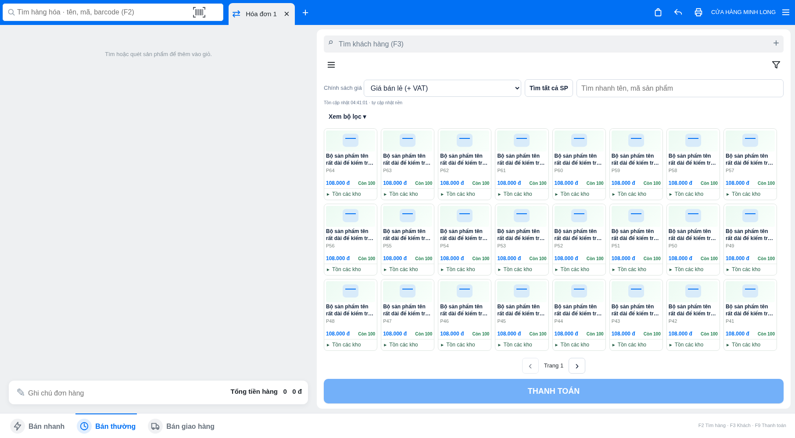

# POS: danh mục 24 sản phẩm mỗi trang

Thay đổi trực tiếp theo yêu cầu của chủ CRM, tiếp nối PR #824 đã có trên main. PR #826 hiện nhắm main. Hai yêu cầu bổ sung về dòng hàng và thao tác chọn sản phẩm được ghi tại [báo cáo kiểm thử](../pos-under-sku/README.md).

## Tái hiện và kết quả

- Main `7e61ff76`: kiểm thử bằng 68 sản phẩm thật trong DB PGlite cục bộ; màn hình Bán thường dựng 60 thẻ ngay trang đầu. Kiểm tra yêu cầu 24 thẻ thất bại (`60 !== 24`). Cuộn còn tiếp tục nối sản phẩm vào cùng lưới.
- Sau sửa: cùng dữ liệu chia thành **24 / 24 / 20**, 8 cột × 3 hàng. Chỉ trang hiện tại được dựng trong DOM; mũi tên trước/sau khóa đúng ở đầu/cuối danh sách. Giữ cơ chế đọc catalog và cache tồn hiện có, không đổi API.
- Tìm nhanh cạnh chính sách giá dùng cùng truy vấn với ô tìm trên đầu trang; không tạo luồng tìm kiếm riêng. Các bộ lọc Tất cả / Còn hàng / Còn ít hàng / Hết hàng áp dụng trước khi chia trang. Bộ lọc ít kết quả có thể đọc thêm các trang nguồn để tìm đủ sản phẩm; đổi truy vấn, quầy, bảng giá, hóa đơn hoặc chế độ sẽ dừng lượt điền trang cũ.
- Giữ lựa chọn sản phẩm, ảnh, giá, tồn, nút xem tồn các kho, dạng danh sách và thao tác giỏ hiện có. Thẻ có chiều cao tối thiểu, tên đầy đủ còn trong tooltip. Màn hình hẹp cuộn bên trong danh mục để giữ đủ tám cột; không đẩy tràn toàn trang.
- Hai nút nổi Chat / Nhắc chăm sóc nhanh được ẩn ở POS, hiện lại khi sang trang CRM khác. Không thay quyền hoặc xóa module.
- Giỏ tự xếp lại khi cột giỏ hẹp, tương thích với CK trực tiếp và nút số lượng từ #824.

## Kiểm tra

`scripts/testing/pos-catalog-pages.mjs` chạy Chromium và router thật với DB PGlite riêng:

- 1812, 2214, 1280, 1024px: đúng 24 / 24 / 20, tám cột và ba hàng, tiến/lùi không mất hoặc trùng mã.
- Hai kích thước rộng hiển thị đủ ba hàng không cuộn dọc. Trường số lượng và CK nằm trong cột giỏ.
- Tìm theo mã, xóa tìm kiếm, đồng bộ hai ô tìm, đổi bảng giá, lọc hết hàng và giữ giỏ.
- Kiểm tra cả snapshot tồn, tìm trực tiếp qua máy chủ và catalog metadata có mã chưa nằm trong cache; kết quả truy vấn cũ trả chậm không ghi đè kết quả mới.
- Hai icon ẩn trong POS và hiện ngoài POS. Không ghi đơn hàng, thanh toán hoặc vận đơn khi thực hiện các thao tác danh mục.

Các kiểm tra bổ sung đã qua:

- 64 unit/architecture/asset-version tests liên quan.
- `pos-reference.mjs` của #824, chạy với giao diện kết hợp: 2214, 1812, 1440, 1280, 1024, 390px; CK theo phần trăm và tiền, tăng/giảm số lượng, kiểm tra che khuất, COD.
- Các harness `pos-reference.mjs` và `pos-workspace.mjs` trước đó cũng qua: ba chế độ, quét mã, QR, thanh toán và giao hàng, bao gồm điện thoại.
- `npm run typecheck`, `npm run ui:build`.

Tất cả dữ liệu/ảnh trong kiểm thử là giả lập; chặn kết nối bên ngoài. Không dùng DB production, không tạo migration, không gọi SePay/GHN/Sapo thật.

