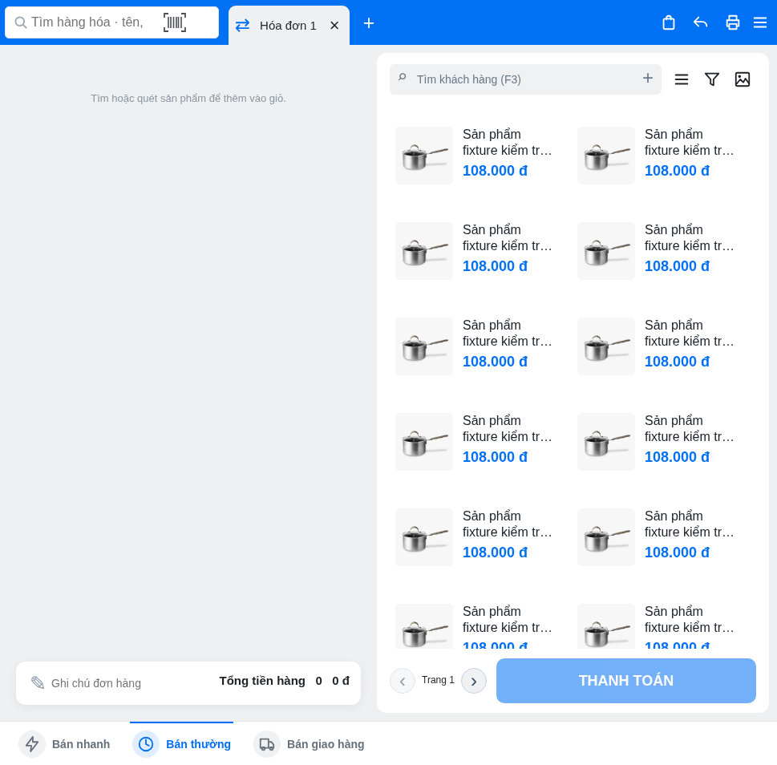
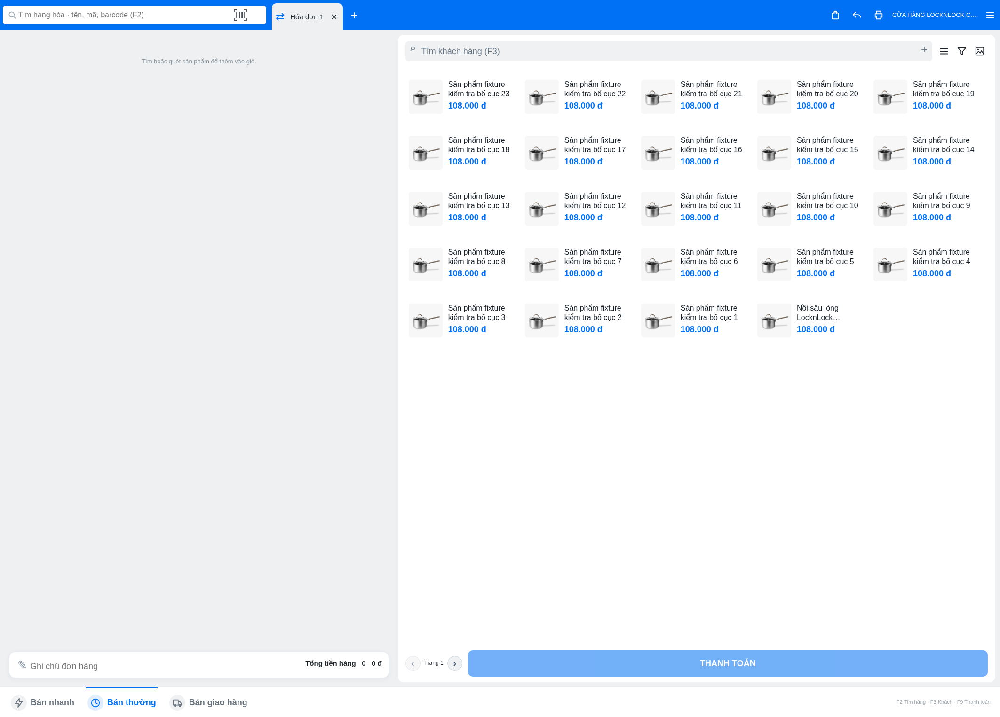

# Danh mục Bán thường dạng ngang

Theo ảnh mẫu mới: ảnh vuông bên trái, tên và giá xanh bên phải, không đè giá lên ảnh. Thanh tìm khách cùng hàng với icon danh sách/bộ lọc/ảnh; phân trang cạnh nút thanh toán. Số cột thích ứng theo chiều rộng, không cố định 8 cột gây cuộn ngang.

Bảng giá, tìm nhanh, lọc tồn và xem tồn các kho nằm sau icon bộ lọc. Mã SKU vẫn có trong title của sản phẩm; hàng hết tồn/chưa xác nhận vẫn có cảnh báo và giữ điều kiện khóa chọn. Không thay URL ảnh, phép tính, phân quyền hoặc API. Mobile và Bán nhanh giữ bố cục riêng.

## Kiểm chứng

- Chromium + router/PGlite fixture tại 969×954, 2126×1526, 390×844: ảnh contain, không đổi nguồn; ảnh nằm trái tên và giá nằm dưới tên, không tràn ngang; icon mở bộ lọc, chuyển danh sách/ảnh, phân trang hoạt động. Bấm ảnh thêm số lượng 1; bấm lại tăng lên 2 ở cùng dòng.
- Harness phân trang hiện có tại 2126×1526, 1812/2214/1280/1024×1000: trang 24/24/20 không mất/trùng sản phẩm, tìm nhanh, tìm trong cache và API dự phòng, đổi bảng giá, lọc và giữ giỏ hoạt động; không ghi đơn/thanh toán/giao vận.
- 9 tests stamp-ui-version và ui:build qua; git diff --check sạch.

Ảnh dưới dùng fixture giá/tồn/cửa hàng giả. Ảnh nồi LHD1141 từ trang LocknLock công khai, lặp trên các mã TEST để kiểm bố cục; không phải danh mục production. Không thay ảnh trong CRM. Harness mặc định dùng SVG fixture, có thể truyền POS_PHOTO_PATH để dùng ảnh thật cục bộ.

Chưa merge/deploy.
