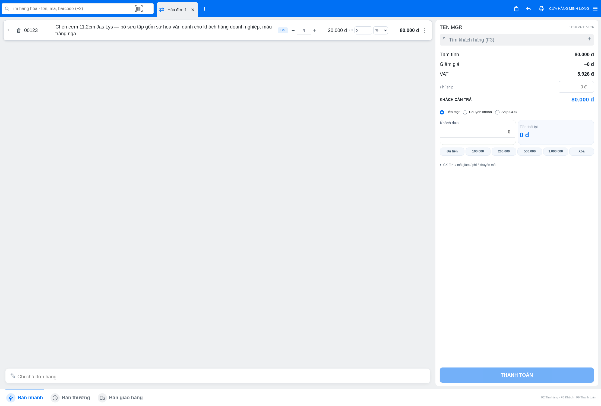

# POS: chuông, chiết khấu và số lượng

Ba thay đổi chủ shop yêu cầu ngày 24/11/2026:

1. Ẩn nút nổi “Cần duyệt” trên POS. Khi rời POS, nút vẫn theo quyền và luồng duyệt
   hiện có. Cập nhật số việc nền không thể làm nút hiện lại trên POS.
2. Đưa ô CK và lựa chọn `% / đ` ra trực tiếp trong dòng hàng, ở cả ba chế độ.
   Dùng lại đúng input/select và handler hiện có, không nhân bản ô hay đổi phép tính.
3. Đặt `−`, ô số lượng và `+` chung một nhóm. Không còn nút tăng số lượng ở cuối dòng.

Giữ thao tác xóa dòng trong menu. Không thay API, quyền, dữ liệu, phương thức thanh
toán hay chức năng khác. Màn hình hẹp sắp xếp các ô xuống hàng để không ép tên hàng.

## Kiểm tra

- Browser với router/PGlite và dữ liệu mồi: 2214, 1812, 1440, 1280, 1024 và 390px;
  0 pageerror, không tràn ngang. Đã dùng tên hàng dài.
- Kiểm nút cần duyệt ẩn trên POS, hiện khi rời POS và vẫn ẩn sau khi đổi thuộc tính
  mô phỏng cập nhật nền. Không sửa module tải số việc hoặc luồng duyệt.
- CK hiện trực tiếp; 4×20.000đ giảm 10% còn 72.000đ, giảm 5.000đ theo dòng còn
  75.000đ, trở lại CK 0% là 80.000đ. Chuyển chế độ giữ giỏ và vẫn thấy CK.
- `+` tăng 4→5 (100.000đ); `−` đưa về 4 (80.000đ). Hai nút ở cạnh input số lượng.
- Bài browser hiện có vẫn kiểm thêm bộ lọc, đơn web, COD cập nhật sau review và
  không ghi thu COD chưa thu. 50 test POS/money/approval-launcher/architecture đạt;
  typecheck và UI build exit 0.

Chạy browser: `node --import tsx scripts/testing/pos-reference.mjs` với
`PLAYWRIGHT_MODULE` trỏ tới Playwright. Không gọi production hoặc GHN/SePay thật.
Chưa merge/deploy.
