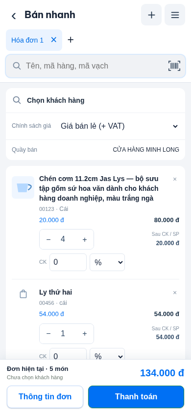
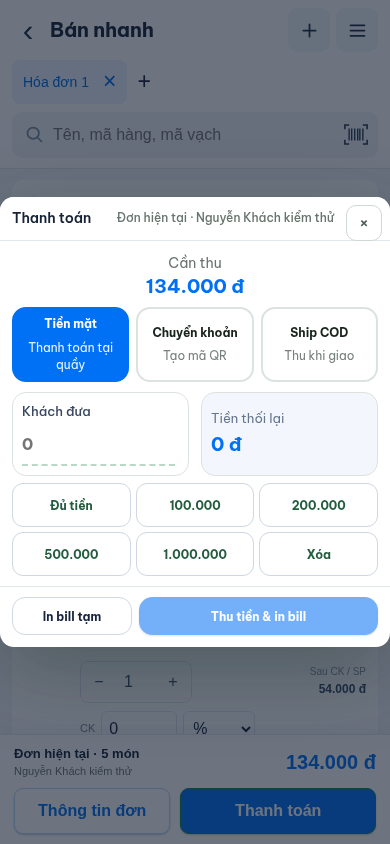

# Mobile Bán nhanh theo bố cục KiotViet

Phạm vi: chỉ POS ở chế độ Bán nhanh (`scan`) khi màn hình rộng tối đa 850px. Desktop và chế độ Bán thường/Bán giao hàng giữ giao diện hiện có.

## Tham khảo

Đã xem ảnh phần IV – Thao tác trên Điện thoại trong [hướng dẫn bán hàng chính thức của KiotViet](https://www.kiotviet.vn/huong-dan-su-dung-kiotviet/retail-ban-hang/ban-hang/), gồm chọn hàng, hóa đơn và thanh toán:

- [Chọn hàng](https://cdn-kvweb.kiotviet.vn/kiotviet-website/wp-content/uploads/2025/10/01035138/BHR011025-10.png)
- [Thông tin hóa đơn](https://cdn-kvweb.kiotviet.vn/kiotviet-website/wp-content/uploads/2025/10/01035142/BHR011025-11.png)
- [Thanh toán](https://cdn-kvweb.kiotviet.vn/kiotviet-website/wp-content/uploads/2025/10/01035153/BHR011025-13.png)

Áp dụng cách bố trí: thanh tìm/quét trên đầu, khách hàng/bảng giá/quầy bán, danh sách hàng gọn với ảnh và số lượng, tổng tiền và thanh toán cố định phía dưới. Ảnh tài liệu KiotViet không đưa vào mã nguồn hoặc ảnh demo.

## Thay đổi

- `pos-mobile.js` sắp xếp lại các nút và input thật của POS, giữ handler và trạng thái của chúng. Menu chứa thao tác ca/quầy, hủy đơn, trả hàng, báo cáo và các mục sẵn có.
- Nút cộng trên thanh đầu mở danh mục hiện có. Chọn hàng giữ quy tắc cộng một, xóa truy vấn và focus lại ô quét. Có ảnh hàng, mã/ĐVT, giá, thành tiền, số lượng và CK trong từng dòng.
- Giữ tab nhiều hóa đơn, cơ chế tự lưu nháp, khách hàng bắt buộc và ba phương thức Tiền mặt/Chuyển khoản-SePay/Ship COD. Thông tin đơn, phí, ghi chú và giảm giá vẫn truy cập được từ phần chi tiết.
- Trang thanh toán hiển thị số tiền cần thu lấy từ preview hiện có. Không thay phép tính, payload, API, quyền hoặc dữ liệu.
- CSS chỉ có hiệu lực trên `.pos-mobile-quick` và màn hình tối đa 850px. Thanh điều hướng CRM hiện lại khi rời trang. Ảnh dòng hàng được ngừng theo dõi khi dựng lại để không giữ observer của phần tử cũ.
- CSS mới được preload và gắn phiên bản theo nội dung qua cơ chế release hiện có.

## Kiểm tra

- Trước sửa: harness mới không tìm thấy bố cục mobile (`0 !== 1`), đã chụp giao diện cũ.
- `scripts/testing/pos-mobile-quick.mjs`: Chromium + API/router thật + DB PGlite riêng tại 320, 390, 430, 768px. Kiểm tra tìm/quét, mở/đóng camera giả lập, chọn hàng, tăng/nhập số lượng, CK, tổng tiền 134.000 đ, chọn khách và mở thanh toán, chuyển hai hóa đơn và bảo toàn giỏ.
- Kiểm tra bố cục thanh đầu, vị trí camera, không tràn ô nhập, thanh tổng tiền/Thanh toán trong viewport. Đổi kích thước qua desktop, Bán thường và Bán giao hàng xác nhận scope; rời POS vẫn có thanh điều hướng CRM.
- `pos-reference.mjs`: các màn hình desktop 2214, 1812, 1440, 1280, 1024px và mobile 390px qua, bao gồm CK %, CK tiền và COD. Không có lỗi JavaScript trong trình duyệt.
- 64 unit/architecture/asset-version tests, `npm run typecheck`, `npm run ui:build` qua.

Các ảnh bên dưới và dữ liệu đều giả lập. Bộ kiểm thử chặn kết nối bên ngoài; không dùng production, không tạo đơn/thu tiền/vận đơn thật. Camera được giả lập trong kiểm thử, không kiểm chứng phần cứng iPhone/Android.

