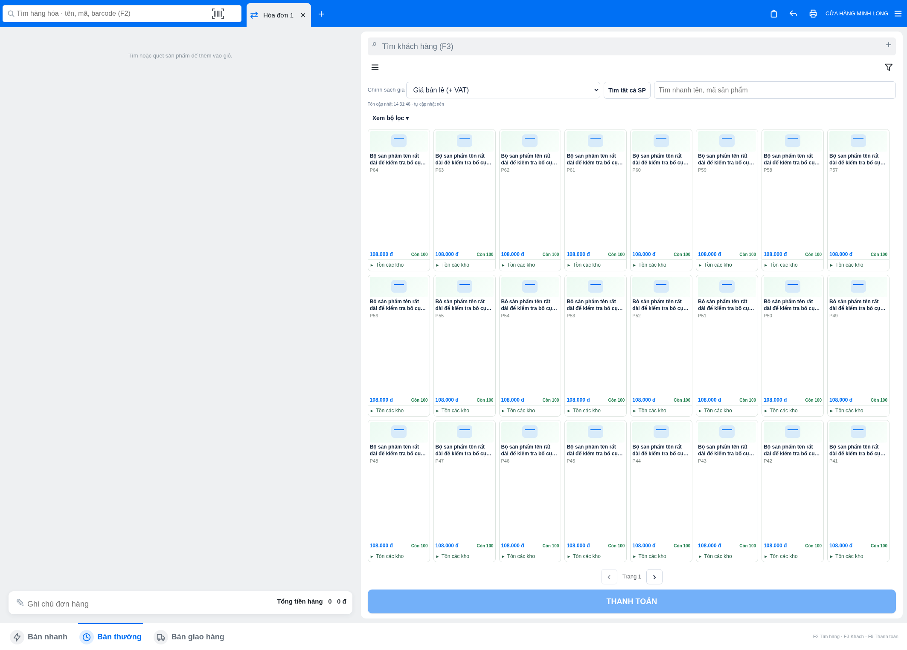
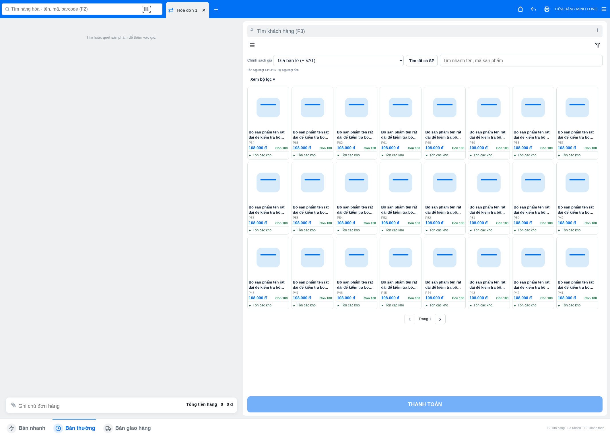

# POS Bán thường: vùng ảnh sản phẩm theo mẫu KiotViet

Ảnh trước/sau dùng dữ liệu giả và ảnh SVG giả trong Chromium; không chứa dữ liệu khách hàng. Đối chiếu bố cục với tệp `bán hàng thường.mhtml` người dùng cung cấp, không thực thi script trong tệp mẫu.

## Thay đổi

- Bỏ chiều cao ảnh cố định 48px. Vùng ảnh dùng khoảng trống của thẻ, tối đa 160px, căn giữa và giữ trọn ảnh bằng `object-fit: contain`.
- Giới hạn chiều cao ba hàng theo chiều rộng danh mục để thẻ không kéo dài hết màn hình cao, giảm khoảng trắng giữa ảnh và thông tin.
- Giữ 8 cột × 3 hàng, mũi tên phân trang, giá/tồn kho, tìm kiếm, bộ lọc và thao tác thêm vào giỏ. Kiểu danh sách vẫn dùng quy tắc riêng hiện có.
- CSS ứng dụng chỉ áp dụng cho Bán thường trên desktop (từ 851px). Không thay URL ảnh gốc, pipeline thumbnail, API, giá tiền, quyền hay dữ liệu production.

## Kiểm chứng

Trước sửa, harness có assertion mới thất bại tại 2126×1526: `product photos must use the card image area, not a fixed 48px strip`.

Sau sửa, `scripts/testing/pos-catalog-pages.mjs` hoàn thành thành công tại 2126×1526, 1812×1000, 2214×1000, 1280×1000 và 1024×1000:

- Mỗi trang 24/24/20 sản phẩm, đúng 8 cột và 3 hàng; không mất hoặc trùng mã giữa các trang.
- Tại viewport người dùng, mọi vùng ảnh cao ít nhất 100px và ít nhất 70% chiều rộng; vẫn `contain` và giữ nguồn ảnh gốc của fixture.
- Ba hàng không cần cuộn dọc trên các viewport rộng; không tràn ngang toàn trang hoặc lỗi JavaScript.
- Tìm kiếm, bộ lọc, cache/fetch dự phòng và giữ giỏ hàng hoạt động; thao tác danh mục không ghi đơn, thanh toán hoặc giao vận.

Fixture được gắn nhãn `MINH LONG I` đúng với cửa hàng Minh Long trong bài kiểm tra, phù hợp quy tắc lọc thương hiệu hiện có trên main.

```sh
PLAYWRIGHT_MODULE=/opt/codex/cua_node/lib/node_modules/playwright/index.mjs \
  node --import tsx scripts/testing/pos-catalog-pages.mjs
node --import tsx --test tests/app/stamp-ui-version.test.ts
npm run ui:build
```

9 kiểm tra version/cache tài nguyên đạt; build giao diện thành công. Không merge/deploy trong bước này.

## Ảnh trước và sau (2126×1526)

Trước sửa:



Sau sửa:


