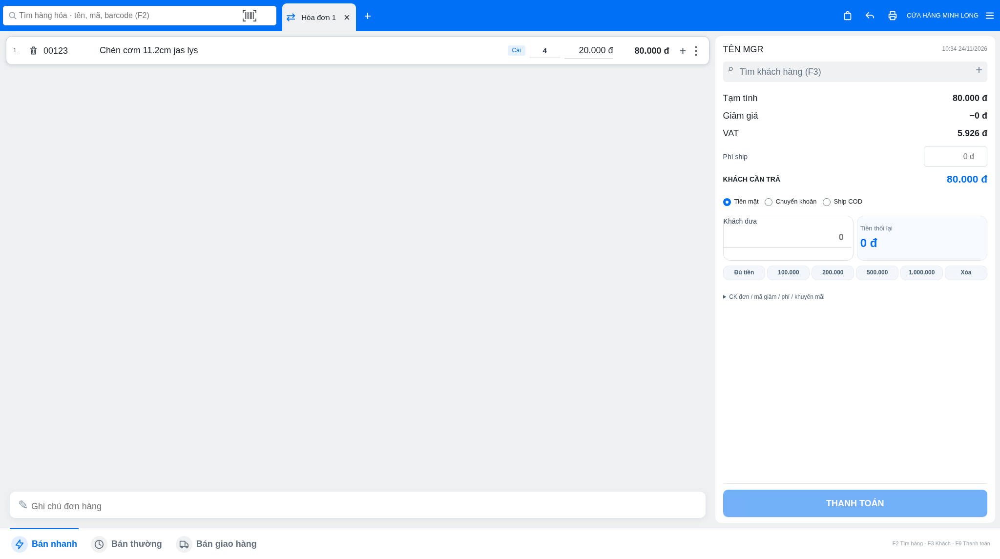
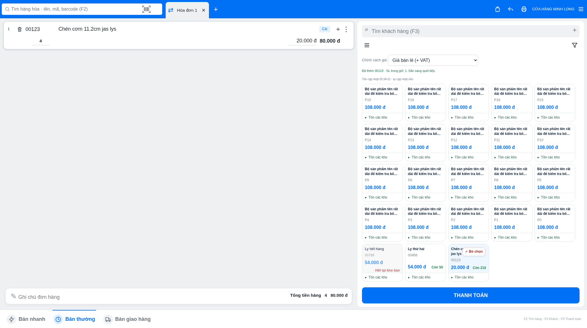
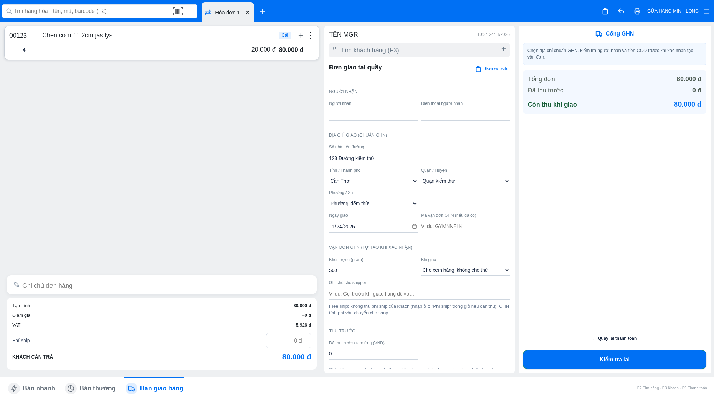
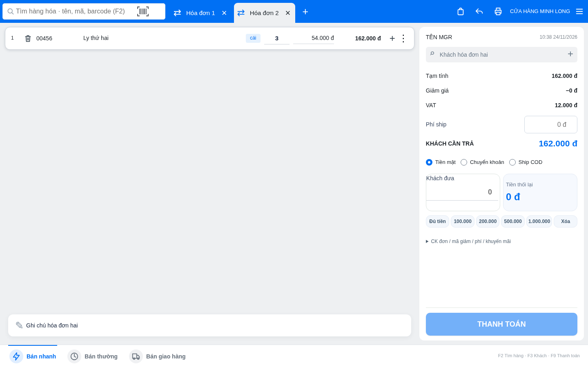

# Giao diện POS theo ba mẫu chủ shop cung cấp

Ngày 24/11/2026. Nhánh `codex1/pos-reference-layout`, nền main `4233e6bd`.
Yêu cầu trực tiếp của chủ repo; làm riêng với việc điều tra tiền bill ở #780.
Đã gộp main `80980325` (#817), giữ thẻ kết quả tìm nhanh ngang với hai hàng đầy đủ.

Đã đọc DOM/CSS của cả ba tệp đính kèm (tệp giao hàng có đuôi .html nhưng nội dung
thực tế là MHTML). Không nhúng ứng dụng, script, tài khoản hay quảng cáo trong
snapshot vào CRM.

## Kết quả

- **Bán nhanh:** thanh tìm/quét màu xanh, hóa đơn hiện tại, dòng sản phẩm một hàng,
  ghi chú bên trái; khách hàng, tiền hàng, phương thức và nút thanh toán bên phải.
- **Bán thường:** giỏ bên trái, danh mục thật bên phải, giữ bảng giá/bộ lọc/xem tồn;
  nút thanh toán mở các điều khiển thanh toán hiện có trong cột phải.
- **Bán giao hàng:** ba cột giỏ, người nhận/địa chỉ và Cổng GHN. Nút Đơn website
  mở danh sách web hiện có với bộ lọc và các thao tác GHN theo quyền hiện có.
  Không sao chép đơn web vào giỏ POS hay tạo lại đơn/vận đơn khi chuyển chế độ.
- Form GHN dùng lại COD hai bước: nhập → kiểm tra → xác nhận. Tiền COD cập nhật
  theo preview mới; thay đổi giỏ làm mất hiệu lực bước kiểm tra cũ. F9 trong chế độ
  giao hàng gửi đúng form COD, không gửi nhầm checkout tại quầy.
- Chuyển ba chế độ giữ giỏ, ghi chú và dữ liệu người nhận; chặn chuyển khi đang gửi
  hoặc chưa rõ kết quả. QR hiện tại phải được xử lý trước khi sang giao hàng.
- Chủ shop đã duyệt thêm nhiều hóa đơn song song, giữ các phương thức thanh toán
  CRM hiện có; không bổ sung Thẻ/Ví. Mỗi tab giữ giỏ, khách, ghi chú và địa chỉ
  riêng theo người dùng/quầy/ca. Đổi tab lấy lại giá/tồn và tính preview mới.
  Đóng nháp có dữ liệu phải xác nhận; khóa đổi/thêm/đóng khi có QR, giao dịch chưa
  rõ kết quả, đang gửi hoặc đang giữ tiền đổi hàng. Thanh toán một tab không xóa
  các tab khác. Tab cũng dùng được khi đổi sang màn hình điện thoại.
- Giao diện mới chỉ áp dụng desktop từ 851px; điện thoại giữ luồng có sẵn.

Ảnh từ bản chạy với dữ liệu mồi, không phải dữ liệu production:

### Bán nhanh



### Bán thường



### Bán giao hàng



### Nhiều hóa đơn song song — đã được chủ shop duyệt



## Kiểm chứng

Node 22.22.0, Chromium, PGlite và router ứng dụng thật trên máy kiểm thử:

- `scripts/testing/pos-reference.mjs`: 5 viewport 2048×1145, 1440×900, 1280×800,
  1024×768, 390×844. Chuyển chế độ không đổi giỏ/không tạo giao dịch; không tràn
  ngang; mọi ô địa chỉ nằm trong cột; 0 pageerror; danh sách hiển thị đơn web mồi.
- Bài test mới chạy với UI của main trước sửa hỏng tại việc chưa có ba nút chế độ
  theo mẫu; sau sửa các viewport và các kịch bản đều đạt.
- Bài mới kiểm thêm Bán thường mở thanh toán; COD 80.000đ được kiểm tra lại, đổi
  SL 4→5 thì trở về bước nhập và COD đổi 100.000đ; xác nhận cuối chỉ gửi một
  checkout; đơn lưu COD 100.000đ, không có phiếu thu khi chưa nhận COD.
- `scripts/testing/pos-workspace.mjs`: đạt 1440, 1366 và 390; lưu nháp, tự nhập SL,
  QR dùng lại, retry không tạo trùng, mobile dùng modal như trước. Chỉ cập nhật tên
  nút kiểm tra từ “Quét nhanh” thành “Bán nhanh” cho đúng nhãn mẫu.
- 56/56 test liên quan đạt: pos-cod-deposit, pos-customer-required, pos-workspace,
  pos-ui, pos-money và architecture. Không skip/todo. Typecheck và UI build exit 0.
- Kiểm tra asset/version và architecture đạt: CSS được preload trong index và
  được gắn mã nội dung khi phát hành; module POS độc lập cũng dùng URL có phiên bản.
  Không dùng CSS import không phiên bản dưới chính sách cache immutable một năm.
- Bổ sung 5 test quản lý hóa đơn (tách scope, khôi phục, đóng/giữ tab khác, dữ liệu
  lỗi và rollback khi storage lỗi). Tổng nhóm test liên quan + asset: 70/70 đạt.
- `scripts/testing/pos-invoices.mjs`: hai hóa đơn khác hàng/khách/ghi chú/địa chỉ,
  reload và đổi desktop/mobile giữ đúng dữ liệu; thu 80.000đ ở hóa đơn 1 chỉ tạo
  một đơn/phiếu thu, hóa đơn 2 vẫn 162.000đ; hủy đóng nháp giữ nguyên tab; QR khóa
  thêm/chuyển tab, không tạo thêm đơn. Dữ liệu đều là fixture.

Lệnh trình duyệt:

```sh
PLAYWRIGHT_MODULE=/path/to/playwright/index.mjs \
  node --import tsx scripts/testing/pos-reference.mjs
PLAYWRIGHT_MODULE=/path/to/playwright/index.mjs \
  node --import tsx scripts/testing/pos-workspace.mjs
```

Danh mục/đơn/thu tiền dùng API hiện có. Test địa chỉ GHN dùng response mồi; không
gọi hãng vận chuyển, SePay, Sapo hay gửi thông báo thật. Không thử máy in vật lý
hoặc Safari. Không đổi API, quyền, RLS, công thức tiền, migration hay dữ liệu
production. Chưa merge/deploy.
