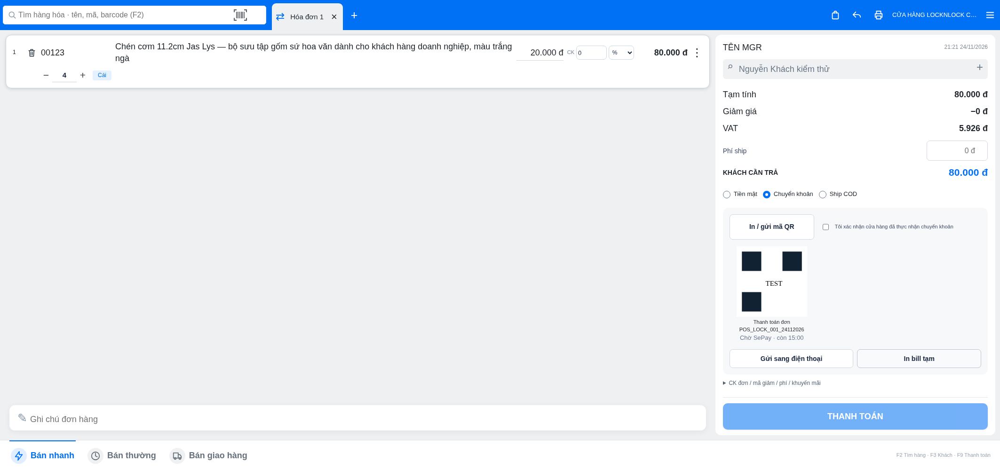
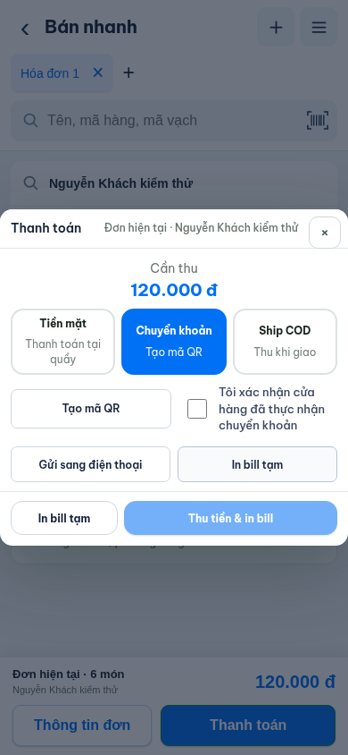

# Nút gửi QR sang điện thoại và in bill trong phần chuyển khoản

Hai nút đặt trực tiếp dưới mã QR/xác nhận chuyển khoản:

- **Gửi sang điện thoại**: dùng lại QR đang mở và luồng gửi QR cho NVBH hiện có. Quầy đã xác định cửa hàng gửi trực tiếp sau khi kiểm tra quyền/nơi nhận. Quầy Sale Admin/không xác định cửa hàng mở lựa chọn cửa hàng trước khi gửi. Điện thoại NVBH đang mở CRM nhận đúng URL QR, số tiền và nội dung gốc.
- **In bill tạm**: dùng `printTemporary()` hiện có, in bill K80 chưa thanh toán và kèm QR còn hiệu lực, đúng số tiền. Không xác nhận đã nhận tiền và không ghi đơn/phiếu thu.

Nút gửi khóa khi chưa có QR, QR đã thu/hết hạn, thiếu preview hoặc giỏ/ca không còn phù hợp. Thao tác gửi dùng lại request hiện có, không tự tạo QR khác. Cờ xử lý chặn bấm lặp; API chia sẻ tiếp tục kiểm tra quyền và cửa hàng như trước. Không đổi API, quyền/RLS, phép tính, mẫu in hoặc DB production.

## Kiểm chứng

- Trước sửa, kiểm tra trình duyệt không tìm thấy nút trực tiếp (`0 !== 1`).
- `scripts/testing/pos-transfer-actions.mjs` chạy Chromium + router/API + PGlite thật tại 2126, 1280, 390px. Kiểm tra bấm lặp, quầy cửa hàng và quầy Sale Admin phải chọn nơi nhận, không tạo thêm QR.
- Đọc API hiển thị trên tài khoản NVBH nhận, so chính xác `id/url/amount` với QR ban đầu. In bill qua iframe thật của ứng dụng, ảnh QR tải từ fixture giả lập; bill ghi “BILL TẠM TÍNH - CHƯA THANH TOÁN”, URL QR giữ nguyên.
- Sau gửi/in, checkbox nhận tiền vẫn chưa chọn; DB không có đơn hàng hoặc khoản thu. Đẩy thời gian trình duyệt qua hạn QR xác nhận không gửi hoặc tạo QR mới.
- 58 unit/UI/asset-version tests liên quan và 2 test API quyền/chia sẻ QR qua (60 test). Typecheck, UI build qua.
- Harness mobile tại 320/390/430/768px tiếp tục qua: camera giả lập, chọn hàng, CK/số lượng, hai hóa đơn, mở thanh toán và phạm vi giao diện. Fixture mobile được gắn brand Minh Long rõ ràng theo chính sách danh mục hiện tại; không nới bộ lọc của ứng dụng.

Tất cả dữ liệu, ngân hàng và QR trong kiểm thử đều giả lập. Hình QR có chữ TEST, không phải mã để thanh toán. Chặn truy cập mạng ngoài; không gửi tới điện thoại thật hoặc sử dụng production.

