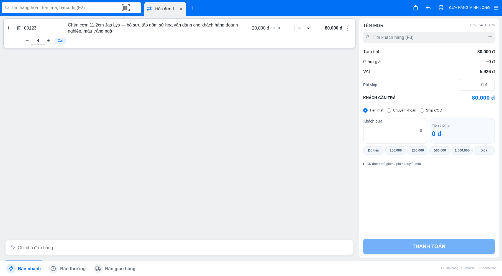

# POS: số lượng dưới mã và chọn sản phẩm cộng một

Hai yêu cầu bổ sung trong PR #826:

- Trên Bán nhanh, đưa nhóm `− số lượng +` và ĐVT xuống cùng hàng ngay dưới mã sản phẩm. Giữ tên, giá, CK và thành tiền rõ ràng; màn hình hẹp tự xuống hàng.
- Bấm thẻ sản phẩm luôn cộng một vào cùng dòng, thay cho chọn/bỏ chọn. Sau khi thêm thành công, xóa cả ô tìm/quét mã và ô tìm danh mục, đưa con trỏ về ô quét mã. Hủy debounce và bỏ qua kết quả tìm cũ trả muộn. Giữ trang hiện tại khi chọn từ danh mục không có truy vấn.

Thẻ đã có trong giỏ ghi “Đã có trong giỏ”. Nút xóa dòng và giảm số lượng vẫn giữ nguyên. Hàng hết tồn, chưa xác nhận tồn hoặc đơn đang khóa không được thêm và không xóa nội dung tìm kiếm. Không thay phép tính tiền, kiểm tra tồn ở máy chủ, quyền hay API.

## Trước và sau

- Trước sửa: kiểm thử mong đợi bấm lại tăng 1 → 2 thất bại vì dòng bị xóa. Unit test xác nhận giao diện cũ ghi “Bỏ chọn”.
- Sau sửa: Chromium kiểm tra quét một sản phẩm rồi bấm lại hai lần: một dòng duy nhất, số lượng 1 → 2 → 3. Ô tìm trống và có focus sau mỗi lần bấm, kể cả sau thời gian chờ debounce. Kiểm tra hình học xác nhận số lượng và ĐVT cùng nằm dưới mã, không chồng nhau.
- Harness `pos-reference.mjs` qua tại 2214, 1812, 1440, 1280, 1024, 390px; CK phần trăm/tiền, các chế độ bán, COD và thanh toán tiếp tục qua.
- Harness phân trang qua tại 1812, 2214, 1280, 1024px; ô tìm danh mục cũng được xóa sau khi chọn, giỏ và trang không mất dữ liệu.
- 64 unit/architecture/asset-version tests qua. Kiểm tra bổ sung hàng đã có trong giỏ nhưng tồn về 0 vẫn không cho thêm: 39 test POS UI qua.
- UI build và typecheck qua. Dữ liệu/ảnh giả lập trong PGlite cục bộ, không tác động production hoặc gọi dịch vụ ngoài.

