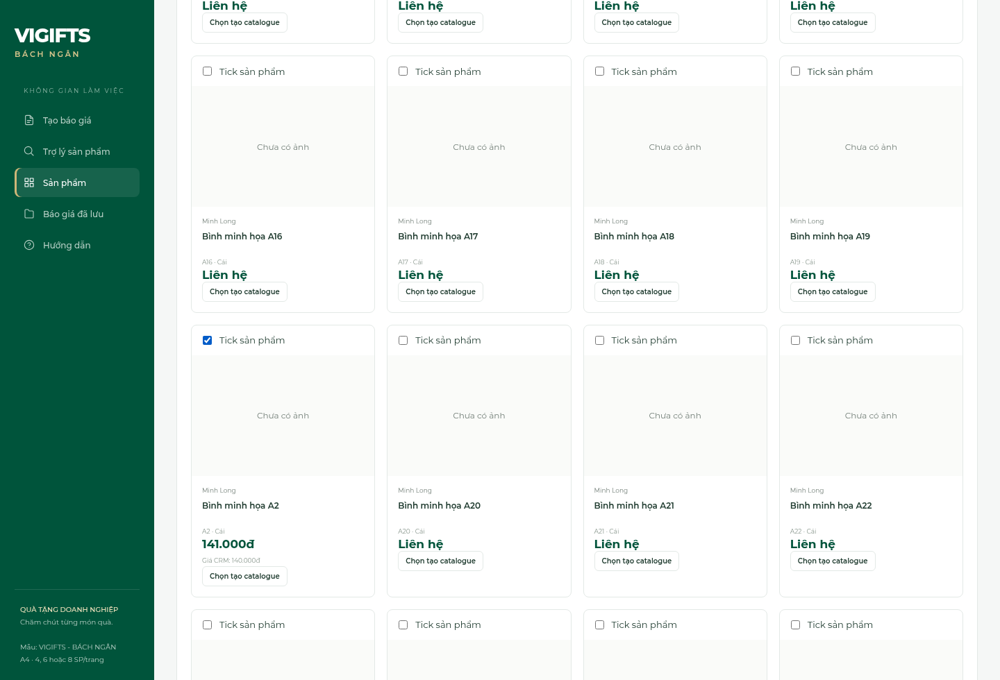
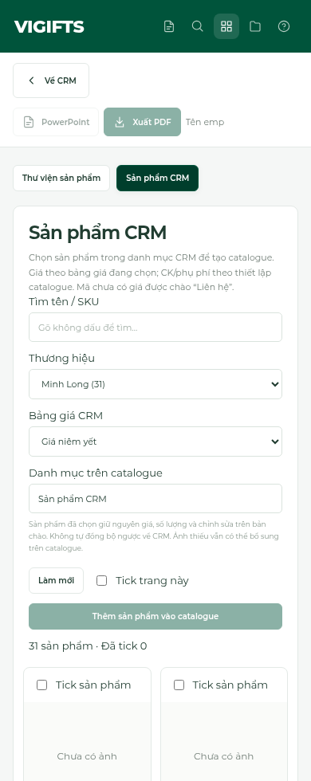
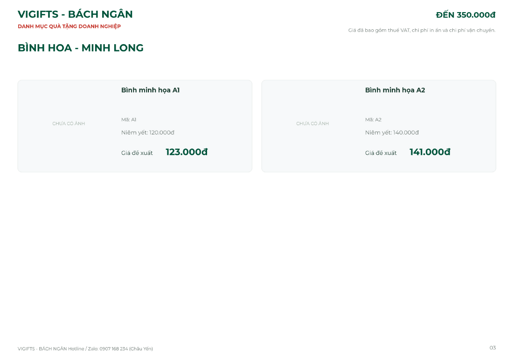

# Sản phẩm CRM trong trang báo giá catalogue

## Hướng dẫn

1. Mở **Tạo báo giá Catalogue → Sản phẩm → Sản phẩm CRM**. Tab **Thư viện sản phẩm** tiếp tục dùng như trước.
2. Tìm theo tên/SKU (hỗ trợ không dấu), lọc thương hiệu. Danh sách phân trang 50 mã; chỉ đọc mã đang hoạt động mà tài khoản được phép xem.
3. Chọn **Bảng giá CRM** làm giá niêm yết của bản chào. Chỉ nhận diện tự động các tên bảng giá niêm yết/lẻ +VAT quen thuộc; nếu không có, phải chọn rõ bảng giá, không tự lấy giá nhập hoặc giá sỉ.
4. Điền **Danh mục trên catalogue** để nhóm sản phẩm khi phân trang. Đây là nhóm trên bản chào, không sửa danh mục CRM.
5. Bấm **Chọn tạo catalogue** ở từng mã hoặc tick nhiều mã rồi bấm **Thêm … sản phẩm vào catalogue**. **Tick trang này** chỉ áp dụng 50 mã của trang hiện tại; đổi bộ lọc/trang sẽ bỏ các tick chưa thêm.
6. Sản phẩm được đưa vào bản chào hiện có. Có thể kết hợp với sản phẩm trong tab thư viện, chỉnh số lượng/chiết khấu/phụ phí trên bản chào, xuất PDF/PowerPoint và lưu báo giá chung theo luồng cũ.

Giá đề xuất dùng công thức catalogue hiện có: giá của bảng CRM được chọn × (1 − CK) + phụ phí. Nhận biết nhóm Lock&Lock/LocknLock và Minh Long bằng quy tắc thương hiệu đang dùng trong CRM; giữ nguyên tên thương hiệu nguồn. Thương hiệu khác mặc định CK 0%. Giá thiếu/0 hiển thị **Liên hệ**, không coi là hàng miễn phí. Tài khoản kho bị ẩn giá sẽ không nhận được giá bán qua tab này.

Chọn lại cùng mã giữ nguyên bản sao đã có: giá, số lượng và các chỉnh sửa không bị ghi đè. Giá CRM cập nhật sau đó không tự đổi bản chào đã tạo. Không tự đăng sản phẩm CRM vào thư viện chung, không ghi ngược sản phẩm/giá/tồn về CRM.

**Quy tắc cũ vẫn áp dụng:** catalogue nhóm theo ngân sách → thương hiệu → danh mục; nhóm còn đúng 1 sản phẩm không xuất thành trang sản phẩm, cần chọn ít nhất 2 sản phẩm phù hợp trong cùng nhóm. Mã không có link website công khai sẽ để trống link/QR; có thể bổ sung link trong form sửa, không tự tạo QR trỏ về trang CRM nội bộ. SKU dài quá 100 ký tự bị chặn với lý do rõ ràng do giới hạn catalogue hiện có.

## Kỹ thuật và triển khai

- Dùng API `/products` và `/product-brands` hiện có qua hai nhánh proxy chỉ đọc `api/crm-products`, `api/crm-brands`. Host/route máy chủ cố định, chỉ chuyển q/brand/offset và ép limit 50; không chuyển URL tùy ý, cookie, danh sách SKU đã ẩn hoặc tham số kho riêng.
- Giữ xác thực/rate limit/CSRF của catalogue; quyền, giá và kho riêng tiếp tục do API CRM quyết định. Không migration, quyền mới, credential hoặc cấu hình Storage.
- Chỉ tải danh sách khi mở tab, tìm có debounce 250 ms; không tải toàn danh mục, không polling. Ảnh dùng thumbnail/lazy loading sẵn có.
- Mỗi SKU có ID bản sao ổn định bằng SHA-256 và trường nguồn `crmSku` trong JSON bản chào. Trường optional được giữ qua lưu chung/khôi phục, kể cả khi sửa SKU hiển thị. Không cần bảng/schema mới.
- Deploy API và UI cùng thay đổi qua quy trình hiện có, API trước UI để giữ metadata nguồn khi lưu. Không bật production từ script kiểm thử.

## Kiểm chứng

Ngày 11/11/2026, dữ liệu tổng hợp cục bộ, không truy cập production.

- **52 test đạt**, **0 lỗi**, **1 test có sẵn bỏ qua** vì cần `TEST_PG_URL` cho lưu đồng thời trên PostgreSQL native. Bao gồm chuyển đổi CRM, policy giá, proxy, phân quyền, thư viện, báo giá, ảnh, an ninh catalogue và kiến trúc. TypeScript và kiểm tra cú pháp đạt.
- Chromium thật ở 1440 px và 390 px: phân trang 50 + 13, tìm không dấu, lọc thương hiệu, tick nhiều, chọn mã thiếu giá, giữ giá khi CRM thay đổi, kết hợp thư viện + CRM, lưu chung/mở lại.
- Xuất PDF thật qua renderer hiện có, PDF 4 trang hợp lệ; trang sản phẩm chứa đúng tên/SKU/giá của hai mã CRM, kiểm tra trực quan bằng ảnh trang 3.
- Không tự tạo bản thư viện, không ghi sản phẩm CRM. Tài khoản kho không có giá bán. Phiên hết hạn xóa kết quả cũ khỏi danh sách; đổi tài khoản và phản hồi cũ đến muộn không hiển thị dữ liệu sai; truy vấn tìm trước trả chậm không ghi đè kết quả tìm sau. Không lỗi JS hoặc tràn ngang trên mobile.
- Mở tab cùng điều kiện cục bộ 3 lần: median khoảng **100 ms**; chi tiết trong [results.json](results.json). Chỉ là fixture 63 mã, không phải tốc độ production và không có phép so sánh trước/sau tương đương.

Chạy lại:

```sh
node --import tsx --test --test-concurrency=4 tests/app/catalogue-crm-products.test.ts
REVIEW_DIR=/tmp/catalogue-crm-products node --import tsx scripts/testing/catalogue-crm-products.mjs
```

Browser harness cần Playwright/Chromium, chặn mọi request ngoài localhost. Có thể đặt `PLAYWRIGHT_MODULE` để dùng module Playwright cài sẵn.






