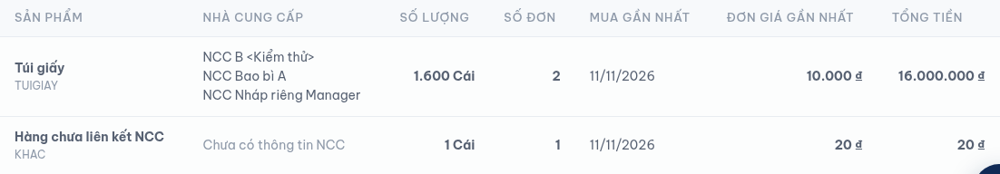
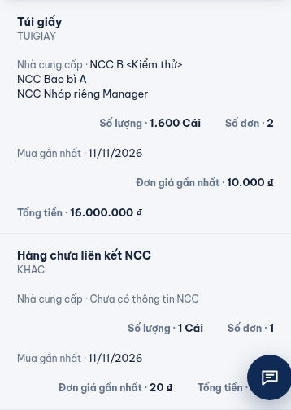

# Customer purchase history: suppliers

Show supplier names next to each purchased product, with mobile labeled cards and a desktop column. The purchase-history tab is now also available on mobile.

Names come from explicit purchase-order source links to the visible counted sales order or its source quote, matched by normalized SKU (trim + uppercase, consistent with existing history grouping). Multiple suppliers are deduplicated and sorted. Names are purchase-order snapshots, not proof of which supplier fulfilled a particular stock unit. Unlinked same-SKU purchases are never inferred. Missing or inaccessible links display “Chưa có thông tin NCC”.

Respect existing customer/sales visibility and purchasing scope. Cancelled purchase orders are excluded. Supplier drafts remain visible only under existing purchase permissions. No supplier prices, contact details or payments are returned. This is one batched query for the existing bounded set of sales orders, using existing source indexes; no per-product request, migration, backfill or production write.

## Validation

- Node 22: TypeScript, trial UI build and `git diff --check` passed.
- Three test files passed: `customer-purchase-suppliers`, `customers`, `customer-shared-edit`.
- New checks cover order and quote source links, signed HĐKT, multiple/deduplicated suppliers, missing links, wrong SKU/source/customer, cancelled sales/purchases, sales drafts, purchaser draft visibility, unauthenticated/supplier/other employee access and unchanged quantities/totals.
- Real Chromium: Manager and customer owner, 390px and 1440px; opens tab, checks names and escaped HTML, missing-name placeholder, no page horizontal overflow, no JavaScript errors. Router + PGlite with synthetic fixtures; external traffic blocked and production region probing disabled only in the test browser.
- Five warm overview requests per role/viewport: local median 20–27 ms in the final run. This is fixture timing, not production latency or a before/after benchmark.

Reproduce:

```sh
node --import tsx --test --test-concurrency=2 tests/app/customer-purchase-suppliers.test.ts tests/app/customers.test.ts tests/app/customer-shared-edit.test.ts
PLAYWRIGHT_MODULE=/path/to/playwright/index.mjs REVIEW_DIR=/tmp/customer-purchase-suppliers node --import tsx scripts/testing/customer-purchase-suppliers.mjs
```

[Browser results](results.json)




