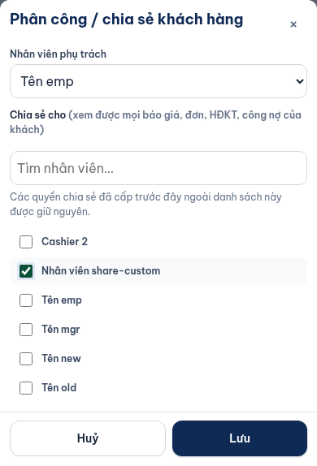
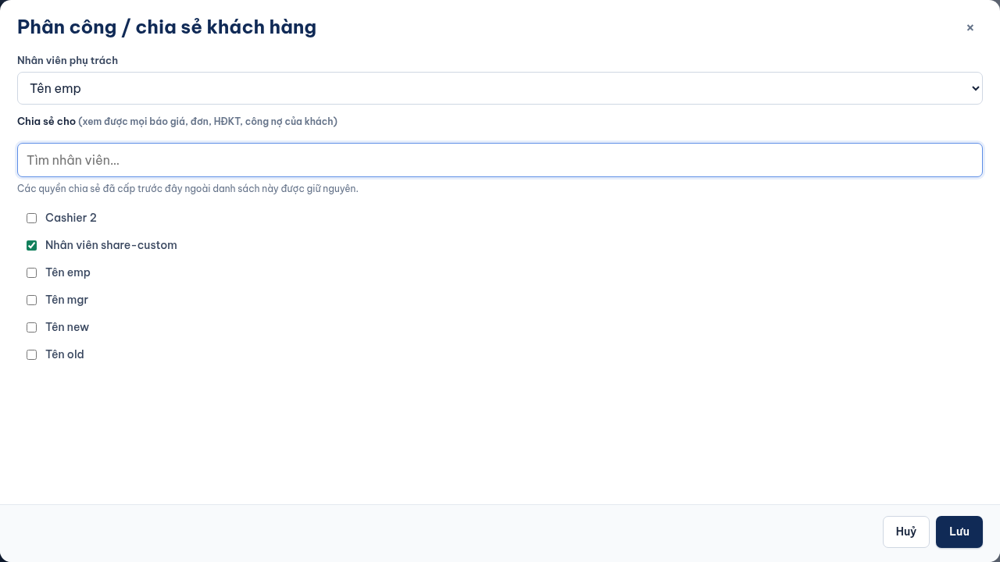

# Customer share recipients

Exclude position IDs `it`, `thiet-ke`, and `warehouse` from new customer sharing. Apply the same rule in customer detail, customer creation, province sharing and API validation. Owner assignment and task recipients retain their existing choices.

Existing shares hidden by this filter are preserved when the dialog is saved, including their original audit metadata. This change does not revoke historical access. Explicit API removal remains available. No schema migration or production data modification is required.

## Validation

- Node 22: TypeScript check and trial UI build passed.
- Four regression test files passed: `customer-share-options`, `customer-create-profile`, `customer-shared-edit`, `customer-province`.
- New API coverage: excluded positions, eligible positions, owner choices, unauthenticated/supplier/unauthorized access, direct API additions, creation, province preview, historical share preservation and explicit removal.
- Real Chromium with the application router and PGlite fixtures: Manager and customer owner at 390px and 1440px. Confirmed excluded checkboxes, preserved owner choices, search, saving, historical share metadata, no dialog horizontal overflow and no JavaScript errors. All external requests blocked; no real customer data used.

Reproduce browser checks:

```sh
PLAYWRIGHT_MODULE=/path/to/playwright/index.mjs REVIEW_DIR=/tmp/customer-share-review node --import tsx scripts/testing/customer-share-options.mjs
```

Recorded fixture results: [results.json](results.json).




