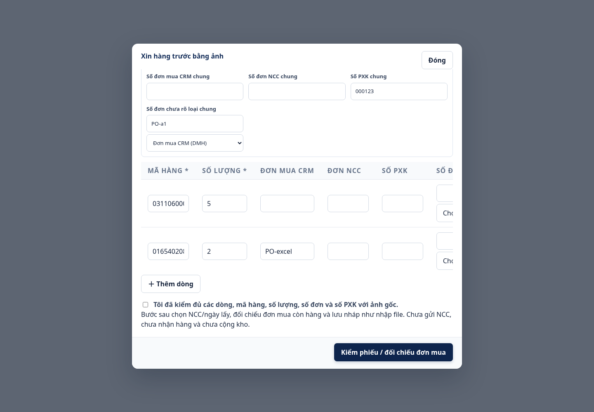
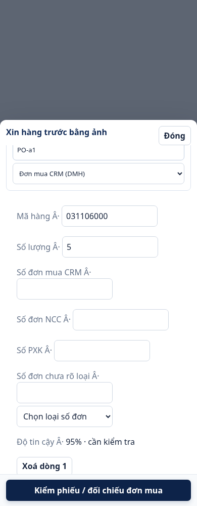
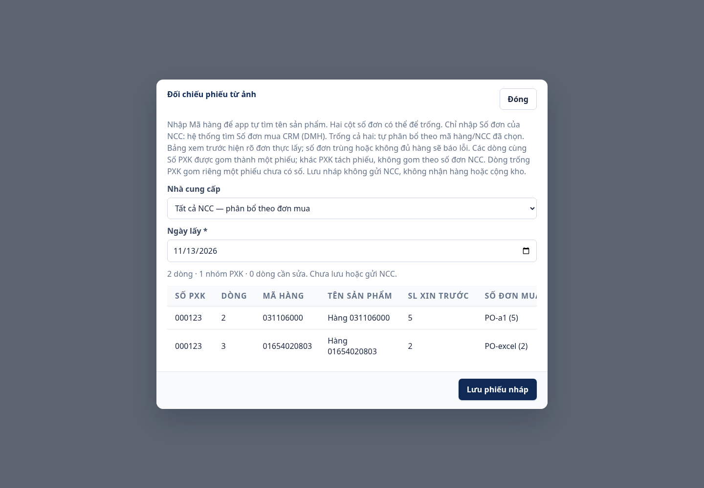

# Xin hàng trước bằng ảnh

Nút **Xin bằng ảnh** nằm cạnh **Xin bằng file** trong Lấy hàng trước, cùng quyền Manager/Sale Admin. Không phải phiếu nhập kho trực tiếp.

1. Chọn ảnh JPG/PNG/WebP (tối đa 10 MB, 24 MP); HEIC đổi sang JPG. Chụp thẳng, rõ phần bảng có tiêu đề Mã hàng/SKU và Số lượng. Mỗi lượt một ảnh, tối đa 300 dòng.
2. Bấm **Đọc ảnh**. Tesseract 6.0.1 với core 6.0.0, mô hình tiếng Việt/Anh chạy ngay trên thiết bị. Tất cả thư viện/mô hình được ghim phiên bản và phục vụ từ CRM; ảnh không tải lên máy chủ hay dịch vụ OCR. Lần đầu tải khoảng 12 MB, các lần sau dùng cache. Nút Đóng đổi thành Dừng đọc ảnh; giới hạn nhận dạng 2 phút.
3. Bấm **Xem ảnh gốc phóng lớn** nếu cần. So đủ các dòng và sửa mã/số lượng/số đơn/số PXK, xoá/thêm dòng. Giữ mã dạng text, kể cả số 0 đầu. Độ tin cậy OCR chỉ để tham khảo: không tự xác nhận dòng có điểm cao. Mã có O/0, I/1 không bị tự thay thế. Số có dấu phân cách cần nhập lại thành số nguyên.
4. Đánh dấu đã đối chiếu ảnh, bấm **Kiểm phiếu / đối chiếu đơn mua**. Đọc thêm số đơn mua CRM, số đơn NCC và số PXK theo tiêu đề cột hoặc nhãn đầu phiếu. Số chứng từ chung áp dụng cho dòng để trống; số riêng từng dòng được ưu tiên. Số đơn chưa rõ loại cần chọn CRM/NCC, không tự đoán từ giá trị. Nhiều số đầu phiếu mâu thuẫn buộc nhập lại trước khi kiểm phiếu. Chuyển mã, số lượng, số đơn và số PXK sang luồng nhập file; bỏ qua giá/VAT/tổng tiền/chữ ký, lấy tên hàng từ CRM. Không tự lấy số cuối dòng làm số lượng khi thiếu hoặc có nhiều cột SL mơ hồ. Trường hợp không nhận dạng chắc chắn yêu cầu nhập thủ công.
5. Chọn NCC và ngày lấy, xem nguồn đơn mua được phân bổ, lượng còn lại, lỗi mã/thiếu hàng như nhập file. Chỉ được lưu khi hợp lệ.
6. **Lưu phiếu nháp** dùng lại endpoint `/purchase-early-requests/file`, khóa/idempotency/phân quyền/kiểm tra số lượng phía server hiện có. Mở phiếu để kiểm tra rồi mới Gửi NCC. Không tự gửi, nhận hàng hay cộng kho.

Không migration, secret, nhà cung cấp OCR trả phí hoặc thay đổi API cần triển khai. Thay đổi chỉ giao diện và thư viện OCR tự lưu. CSP báo cáo cho phép biên dịch WebAssembly (`wasm-unsafe-eval`); không bật JavaScript `unsafe-eval`. Không thay đổi quyền đọc/ghi dữ liệu.

## Kiểm chứng

- Parser test: cột rõ ràng, mã 0 đầu, không tự sửa O/I, từ chối đoán SL từ giá hoặc bảng có nhiều cột SL.
- Các test nhập file, API xin hàng trước, trang danh sách và Manager UI đều đạt (5 file).
- Chromium thật với server/router/PGlite: ảnh PNG tổng hợp có 2 mã 031106000/01654020803, SL 5/2 và cột đơn giá. Tesseract thực đọc đúng mã/SL và số PXK 000123, bỏ qua giá; đọc thêm số đơn CRM từng dòng. Trong ảnh mẫu, PO-a1 bị đọc thành PO-al: kiểm thử giữ nguyên kết quả OCR, nhân viên sửa thành PO-a1, chọn loại đơn rồi mới kiểm phiếu. Payload lưu nháp được kiểm tra đúng PXK 000123 và nguồn PO-a1/PO-excel. PC 1440px và mobile 390px kiểm xác nhận bắt buộc, dùng lại kết quả OCR để kiểm UI, đối chiếu nguồn và lưu nháp thành công với Sale Admin, không lỗi JS. Chặn toàn bộ request ngoài localhost.
- Manager/Sale Admin thấy nút ảnh; kho/Sale/NCC không thấy. Backend vẫn kiểm quyền như nhập file, không tin nút ẩn.
- Chỉ ảnh/dữ liệu tổng hợp được dùng trong kiểm thử; chưa thử ảnh chứng từ thực tế, ảnh mờ/nghiêng hoặc chữ viết tay. Ảnh hoặc chữ viết có thể làm OCR đọc sai mã đơn (1/l, O/0); không tự sửa ký tự. OCR không bảo đảm chính xác mọi chứng từ, luôn cần kiểm ảnh gốc.

```sh
node --import tsx --test --test-concurrency=2 tests/app/early-photo-ocr.test.ts tests/app/purchase-early-file.test.ts tests/app/early-request-page.test.ts tests/app/early-request-manager-ui.test.ts tests/app/purchase-early-requests.test.ts
PLAYWRIGHT_MODULE=/path/to/playwright/index.mjs node --import tsx scripts/testing/early-photo-request.mjs
```





## Sửa CI PR #656

Hai test asset cache thất bại vì loader ghép chuỗi đường dẫn `tesseract.min.js`/`worker.min.js`, trong khi bộ stamp chưa hỗ trợ thư mục có dấu chấm như `ocr-6.0.1`. Loader nay dùng `new URL` với đường dẫn đầy đủ; bộ stamp và bộ kiểm tra asset hỗ trợ thư mục phiên bản, không bỏ qua hoặc whitelist lỗi. Không thay byte/checksum của thư viện, mô hình OCR hoặc CSP.

Kiểm tra sau sửa: 37/37 test OCR/asset/cache/nhập file/list/Manager UI/trial-ui/architecture đạt, typecheck và UI build đạt. Test riêng xác nhận đổi byte engine hoặc worker sẽ đổi hash asset và loader. Harness Chromium phục vụ chính nội dung đã stamp như deploy, xác nhận request engine/worker có `?v=<hash nội dung>`; OCR thật, đối chiếu chứng từ và lưu nháp PC 1440/mobile 390 đều đạt, không JS error và không request ra ngoài localhost. Trang fixture khai báo UTF-8 như trang CRM thật. Kết quả/ảnh local: `/tmp/pr656-fix-browser`.

Chỉ sửa cách tải/đóng phiên bản asset và kiểm thử. Không migration, thay đổi API hoặc dữ liệu production; PR chưa merge/deploy trong lần sửa CI này.
