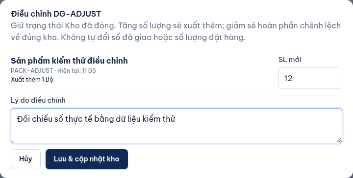
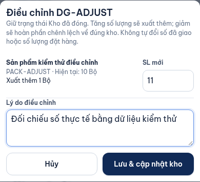
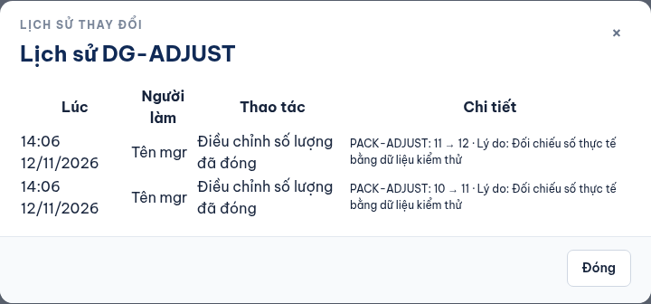

# Manager điều chỉnh số lượng phiếu đã đóng

## Cách dùng

1. Manager mở phiếu đóng gói của đơn CRM/HĐKT ở trạng thái **Kho đã đóng**.
2. Bấm **Điều chỉnh số lượng**. Nhập số lượng mới cho các dòng hiện có và lý do tối thiểu 5 ký tự. Không thêm/xóa dòng, đổi sản phẩm hoặc đổi kho tại đây.
3. Đối chiếu dòng **Xuất thêm / Hoàn về kho**, rồi bấm **Lưu & cập nhật kho**. Chỉ giảm khi số thực tế tại kho đã được đối chiếu; hàng đã giao khách xử lý qua giao hàng/trả hàng.
4. Phiếu giữ trạng thái, người/ngày đóng và ảnh gốc. Tổng số lượng, cân nặng và bản in lấy số mới. **Lịch sử điều chỉnh** hiện ai sửa, thời điểm, số trước/sau và lý do.
5. Nếu giao dịch đã lưu nhưng cầu nối trả 502/mất phản hồi: giữ nguyên nội dung và bấm gửi lại. Cùng mã thao tác được nhận diện, không trừ kho lần hai. Dữ liệu vừa được người khác thay đổi thì tải lại phiếu trước khi sửa.

Nhân viên/Kho không có quyền điều chỉnh; API kiểm Manager độc lập với nút giao diện. Quyền xem phiếu vẫn theo cơ chế đơn/kho hiện có.

## Ràng buộc kho

- Tổng lượng phân bổ trên mọi phiếu chưa hủy không vượt số đặt. Không giảm phần đã bàn giao, đang giao hoặc đã giao khách. Đơn đã hoàn tất còn phải đủ bằng chứng xuất kho.
- Kho xuất không đổi. Chặn thiếu tồn, hàng đang giữ cho đơn khác, kho chưa mở kỳ, số phiếu không khớp sổ kho, thiếu bằng chứng xuất kho, đơn nháp/hủy và hồ sơ trả/đổi hàng.
- Luồng này dành cho CRM/HĐKT. Phiếu POS và đơn cũ đã trừ khi duyệt cần đối soát theo luồng riêng trước, không tự suy luận để cộng/trừ.
- Giữ nguyên dòng xuất ban đầu. Mỗi lần sửa thêm dòng `adjust` thuộc `packing_slip`, tham chiếu `slipId#adjust-revision`. Các nơi tính bằng chứng xuất, giữ hàng, POS, sửa/hủy chứng từ và công cụ đối soát cộng đủ các phiên bản này. Hủy sau nhiều lần sửa chỉ hoàn đúng số xuất ròng.
- Tái sử dụng khóa `stock_holds`, khóa đơn/phiếu, khóa sổ kho và `postMoves`. Ghi số lượng, phát sinh, tồn và audit trong cùng transaction; không sửa lịch sử cũ. Giữ hàng của đơn chỉ tiêu thụ phần tăng, không tự tạo lại giữ hàng khi giảm.
- Không thay giá, số đặt, số đã giao, tiền, phiếu thu hoặc tồn Sapo. Không sửa phiếu production khi kiểm thử. Không cần migration.

## Kiểm thử

- 9 test mới đạt: Manager/nhân viên/Kho/NCC/ẩn danh; tăng/giảm nhiều lần; retry cùng key và xung đột nội dung; hai phiên lưu cùng revision; dữ liệu sai/vượt đơn/thiếu tồn; đã bàn giao; tồn giữ đơn khác; chứng từ cũ/sổ lệch; hồ sơ trả hàng. Kiểm đúng audit, cân nặng, giữ ảnh/người đóng, bằng chứng xuất, giữ hàng kiểu cũ và hủy thật qua API hoàn đúng lượng ròng.
- Các tệp hồi quy `packing`, `packing-own-hold-stock`, `packing-stock-repair`, `legacy-order-holds-query`, `order-stock-holds`, `crm-returns`, `pos-returns` đạt.
- TypeScript, UI build, cú pháp JS và diff check đạt.
- Chromium thật, router/DB fixture, ba vai trò Manager/nhân viên/Kho × 390/1440 px. Manager sửa sau tình huống commit nhưng nhận 502, gửi lại không ghi trùng, xem lịch sử; không lỗi JS/tràn ngang. Chặn mọi request ngoài localhost.
- Ba lượt tải mỗi trường hợp, xóa riêng cache dữ liệu `bn-pc:` trước mỗi lượt, giữ cùng phiên và cấu hình trình duyệt. Manager median: **493 ms mobile**, **543 ms PC**; chỉ một GET chi tiết phiếu/lượt. Xem [toàn bộ mẫu đo](browser-results.json). Đây là thời gian chờ trang fixture sẵn sàng, không phải TTFB/LCP hay tốc độ production; chưa có baseline trước tương đương để kết luận chênh lệch tốc độ.

Chạy lại: `node --import tsx scripts/testing/packing-adjustment.mjs` với `PLAYWRIGHT_MODULE` và `REVIEW_DIR` nếu cần.

## Triển khai

Deploy đầy đủ API và các bộ đọc sổ kho trong cùng bundle trước/đồng thời UI. Sau khi đã có tham chiếu `#adjust-revision`, bản API cũ chỉ đọc tham chiếu gốc sẽ tính thiếu bằng chứng xuất/giữ hàng; khi cần rollback phải giữ phần tương thích đọc mọi lần điều chỉnh. Không sửa hoặc xóa dòng sổ kho để rollback giao diện.
