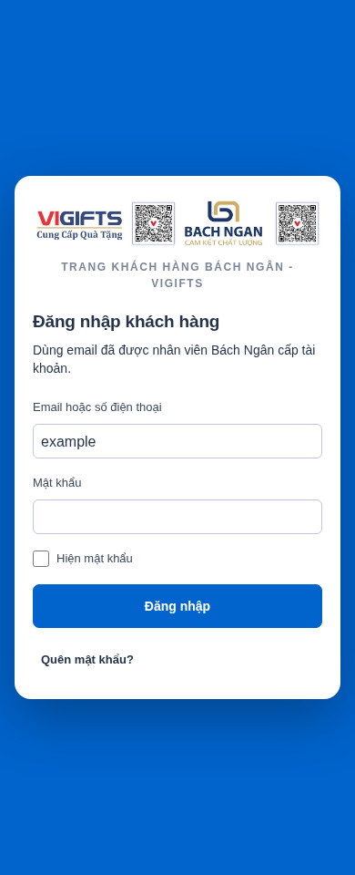
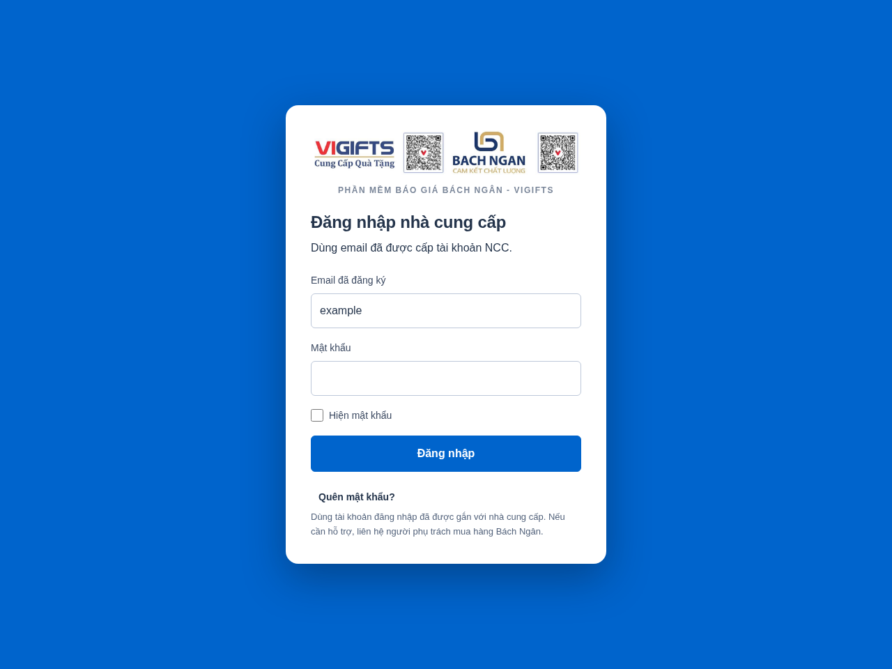

# Shared portal/account theme

PR #820 now reuses the visual-theme.css shipped by #821. CRM index keeps its existing stylesheet order, mobile controls and sidebar styling. The separate kiot-theme.css is removed, avoiding two global themes.

Registration, password reset and customer pages use visual-surface, which only opts into visual tokens/rules. They do not acquire app-shell's mobile height/overflow lock. Supplier portal already had app-shell. Selector :is(.app-shell, .visual-surface) keeps the previous specificity and applies only on screen; print remains unchanged.

Before fix: money-input-ui test failed because kiot-theme.css was the final stylesheet. New wiring/native-scroll test also failed on the old pages. After fix: typecheck/build, money-input-ui, portal-visual-theme, trial-ui, stamp-ui-version and architecture pass.

Read-only Chromium HTML fixtures at390/1280 cover registration, reset, customer and supplier login surfaces: inputs/values/heights, native overflow, primary colour, no horizontal overflow, print styling and no JavaScript errors. Startup scripts are stripped and form sections shown explicitly; this checks CSS, not authentication or business flows. No request outside localhost or form submission is allowed. Existing CRM visual-style browser regression is also run; its obsolete white-sidebar assertion failed on main too and is updated to the explicitly restored navy/white/bold palette, keeping all control/layout/print assertions; Safari and real devices are not tested.

No migration. Rollback: revert the portal HTML links/class and shared-selector change together; leave current CRM theme and data unchanged.
