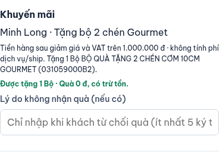
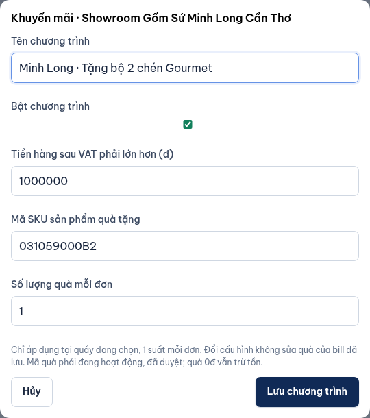
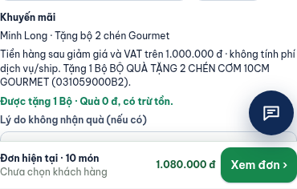
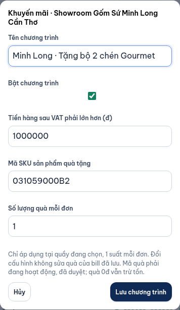

# Khuyến mãi quà tặng POS

Mặc định duy nhất tại **Showroom Gốm Sứ Minh Long Cần Thơ**: tiền hàng sau chiết khấu/voucher và VAT **lớn hơn 1.000.000đ** được tặng **1 bộ 031059000B2**. Đúng 1 triệu chưa đủ điều kiện. Không dùng phí ship/dịch vụ để đạt ngưỡng. Một suất mỗi đơn, không nhân theo bội số triệu đồng. Các quầy Lock, Sale Admin và quầy thử không được tự bật chương trình.

## Thu ngân

1. Chọn quầy, mở ca và chọn khách như bình thường.
2. Thêm hàng, nhập số lượng/giảm giá. Mục **Khuyến mãi** dưới giảm giá tự cập nhật điều kiện và quà.
3. Khi đủ mức, hệ thống tự thêm quà 0đ vào bill. Quà vẫn cần tồn khả dụng trong kho quầy; không tự bán âm hoặc lấy kho khác. Thiếu quà thì giao dịch bị từ chối toàn bộ, không lưu bill/phiếu thu một phần.
4. Nếu khách từ chối quà, nhập lý do ít nhất 5 ký tự. Bill lưu lý do, không xuất quà. Để nhận quà trở lại, xóa lý do rồi chờ tính lại giỏ.
5. Thanh toán tiền mặt, chuyển khoản/QR hoặc COD theo quy trình hiện có. Tiền cần thu và tiền COD không tăng vì quà. COD giữ cả hàng và quà; trừ kho khi xuất/giao theo luồng hiện có.
6. Bill in lại giữ nguyên tên, số lượng và quà 0đ của lần bán. Gửi lại cùng giao dịch không xuất hoặc thu lần hai.
7. Khi trả hàng khiến giá trị hàng còn lại không đủ mức khuyến mãi, chọn nhận lại đủ quà cùng phiếu trả. Quà không làm tăng tiền hoàn. Quà đã xác nhận thực nhận trên phiếu trước được tính; phiếu quà còn chờ nhận chưa được tính. Hủy nhanh toàn bill hoàn lại cả số lượng bán và quà, chỉ hoàn tiền đã thu.

## Manager: đổi chương trình sau này

1. Chọn đúng quầy trên POS.
2. Trong **Khuyến mãi**, bấm **Cấu hình**.
3. Đổi tên chương trình, bật/tắt, ngưỡng tiền, mã SKU quà và số lượng quà mỗi đơn. Dùng SKU thật trong CRM. Khi bật, quà phải hoạt động và được duyệt.
4. Bấm **Lưu chương trình**. Cấu hình chỉ tác động đến quầy đang chọn. Có revision chống ghi đè và audit người thay đổi; nhân viên không có quyền lưu qua API.
5. Giỏ cũ cần tính lại khi cấu hình đổi. Bill đã lưu giữ snapshot cũ. Đổi quà miễn phí không làm mất nhận diện khoản QR đã thanh toán; thu thêm tiền mặt cho giỏ đã nhận QR bị chặn.

Mỗi quầy có một cấu hình đang dùng, thay được loại quà cho chương trình kế tiếp. Chưa có lịch tự bật/tắt hoặc cộng dồn nhiều chương trình. Đơn COD đã chốt trong chương trình đang bật được sửa thông tin/ghi chú nhưng giữ nguyên hàng/giá; cần đổi hàng thì hủy trước xuất theo luồng hợp lệ và lập đơn mới để tính lại điều kiện. Không tự hồi tố quà cho bill cũ.

## Triển khai

Migration `migrations/postgres/20261113054030_pos_promotion_programs.sql` tạo bảng cấu hình có RLS và seed bằng đúng tên showroom đã kiểm tra, kèm SKU thật. Không seed theo chuỗi chứa hoặc theo kho dùng chung. Cần áp dụng migration trước API mới. Gói này chưa chạy migration, chưa deploy, chưa tạo đơn thật.

## Kiểm thử

- Node 22 TypeScript, build trial UI và diff check.
- Sáu kịch bản mới trong `pos-promotions.test.ts`: biên ngưỡng, VAT/giảm giá/phí, đúng quầy, cấu hình Manager/stale revision/SKU sai, migration seed, từ chối quà, bán và tặng cùng SKU, thiếu tồn rollback, checkout replay, full cancellation, partial return và nhận quà 0đ, QR, đổi cấu hình sau nhận QR, COD giữ/xuất hàng và sửa thông tin.
- Regression đạt: POS, UI POS, trả hàng, hủy nhanh, sửa đơn, ghi chú/QR, COD thu trước, sửa GHN và kiến trúc module. Bộ cuối sau sửa bảo vệ QR: `pos-promotions`, `pos`, `pos-note`, `pos-returns` đều đạt.
- Chromium thật + router/PGlite, fixture giả và chặn kết nối ngoài: Manager/thu ngân tại 390 và 1440px; tự nhận quà, lý do từ chối, xóa lý do, Manager lưu cấu hình, không tràn ngang/lỗi JavaScript. Chế độ thử vùng máy chủ tắt riêng trong fixture localhost.
- Năm lần preview ấm cho mỗi vai trò/viewport, thời gian local được lưu tại [results.json](results.json). Không phải tốc độ production hoặc benchmark trước/sau.

Tái lập browser:

```sh
PLAYWRIGHT_MODULE=/path/to/playwright/index.mjs REVIEW_DIR=/tmp/pos-promotions node --import tsx scripts/testing/pos-promotions.mjs
```









## PR #653 CI correction

The November migration coverage test failed because `20261113054030_pos_promotion_programs.sql` had no entry in `november-migration-coverage.json`. Added a dedicated read-only SQL gate and wired it before Edge Function deployment. The gate checks all required column types/nullability, primary key, foreign keys, validated value constraint and RLS. It neither seeds nor repairs data, so Manager changes to promotion configuration are preserved.

Validation: 10 targeted tests pass (POS promotions, migration coverage and the new gate); the final gate-only run passes 4 tests, including missing/partial schema and repeated READ ONLY execution. Typecheck, UI build and diff whitespace checks pass. Production already has the promotion table: the new gate was run inside `BEGIN READ ONLY` / `ROLLBACK` and passed. No migration or production data changes were made in this correction.
