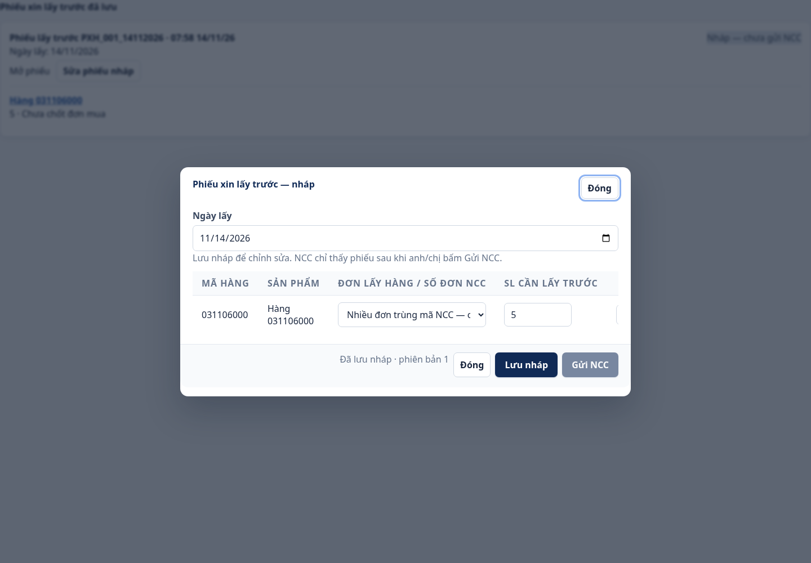
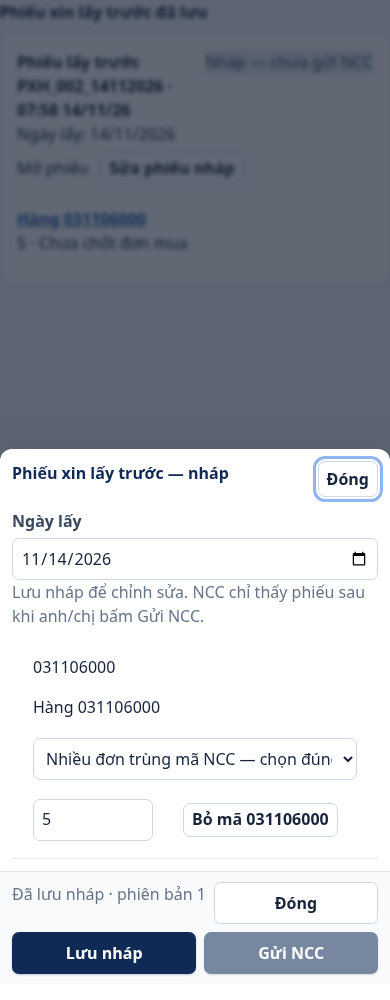

# PR #664: lưu nháp chưa chốt nguồn, giữ ràng buộc nhập file và gửi NCC

CI gốc: run 43533617250, shard 3/4 lỗi tại 3 trường hợp của purchase-early-sources (sai nguồn, mã NCC trùng, vượt nguồn có chỉ định); shard 4/4 lỗi tại early-pxk-file (tổng nhiều nhóm PXK vượt cùng nguồn). API trả 201 thay cho 409 vì allowUnresolved bật mặc định cho mọi lệnh tạo/sửa/file.

## Hành vi cuối

- Màn hình nháp truyền rõ `allowUnresolvedSources:true` khi tạo/sửa, giữ dòng đã biết SKU nhưng chưa chốt được đơn mua, không có allocation giả. Mặc định API cũ giữ strict; nhập file vẫn kiểm tra tổng lượng trên tất cả nhóm PXK trong một transaction và rollback nếu vượt.
- Flag phải là boolean, tham gia fingerprint khi true; không đổi hash của payload cũ khi không bật. Quyền tạo/sửa không đổi.
- Submit luôn revalidate strict và không đọc flag để bỏ kiểm tra. Nháp thiếu nguồn không được NCC thấy, không nhận hàng/cộng kho. UI chặn Gửi NCC đến khi chọn nguồn và lưu lại; server vẫn chặn caller trực tiếp.
- Mã NCC chỉ được tự ưu tiên khi khớp duy nhất; có nhiều đơn trùng phải chọn. Đơn CRM đã ghim được ưu tiên trước matching số NCC. Query có supplier scope. Lựa chọn người dùng không bị callback tải chậm đổi lại.
- Tạo đơn mua bù lấy chính ID từ phản hồi POST để chọn, không suy đoán đơn mới nhất; có chống bấm lặp. Không tự duyệt đơn mua.
- Giữ nguồn đã ghi khi callback không tìm thấy; không tự thay bằng một đơn khác. Chặn tách theo NCC khi còn dòng chưa chốt để không làm mất dòng chưa phân bổ.

## Kiểm thử

- Các test CI hỏng giữ nguyên kiểm tra sai/thiếu/trùng nguồn và giới hạn liên nhóm PXK, đã đạt sau sửa.
- Bổ sung nháp explicit/idempotency/invalid flag, không lách submit bằng flag, nguồn được ghim sau khi sửa, NCC không thấy nháp, không sinh stock_moves/supplier_receipts.
- Bổ sung order-options quyền Manager/Sale Admin, chặn Sale/kho/kế toán/NCC; exact reference không dùng substring; lọc theo NCC.
- Regression danh sách, xác nhận Manager, incoming UI, xoá/tách/tách một phần/nhận hàng và architecture đạt; TypeScript/diff check.
- Chromium + router/PGlite thật, dữ liệu giả, chặn request ngoài localhost: 1440px/390px, số NCC trùng không tự chọn, nháp chưa chốt không gửi được; chọn PO-a2 → lưu → gửi đúng PO-a2, không lỗi JS. [results.json](results.json)

Không migration, thao tác production hay tự gửi thông báo/NCC thật. Full CI sẽ chạy lại trên commit mới của chính PR #664.

