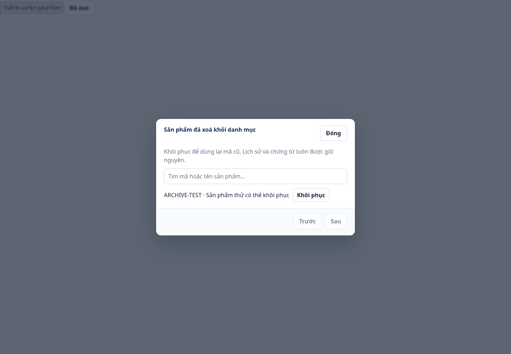
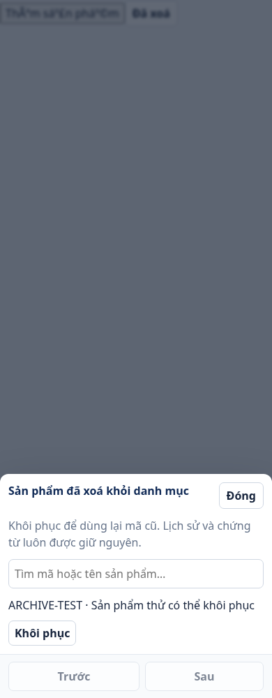
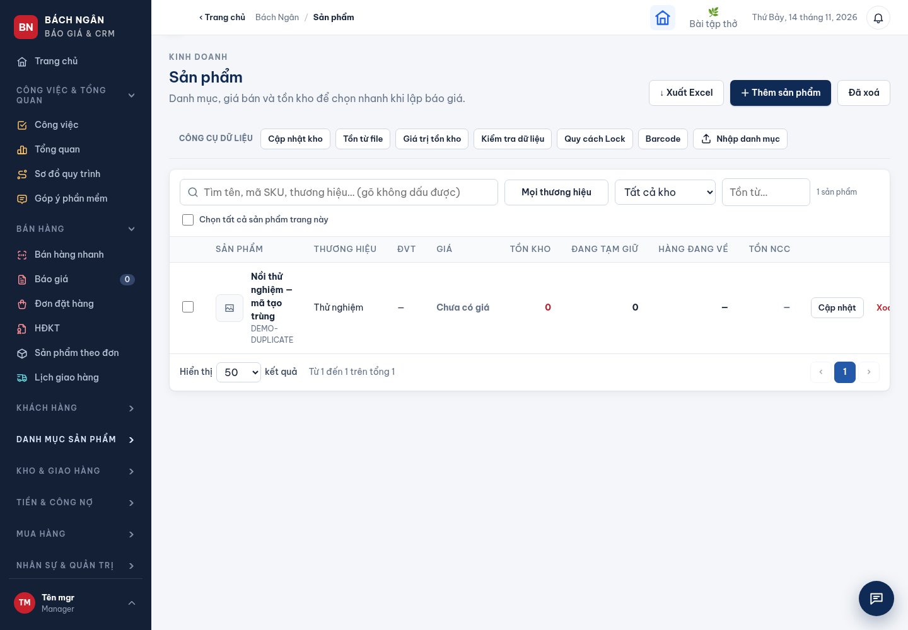
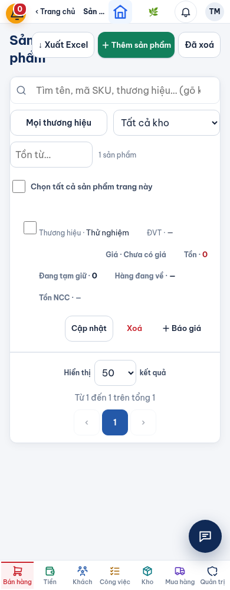
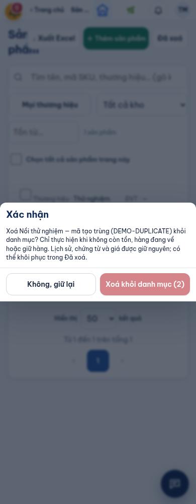

# Xoá sản phẩm khỏi danh mục

Manager thấy nút **Xoá** tại từng dòng trang Sản phẩm. Bấm để xem tên/mã và xác nhận **Xoá khỏi danh mục**. Đây là ngừng sử dụng có thể khôi phục: không xoá vật lý SKU, giá, sổ kho, dòng đơn hoặc chứng từ cũ. Sản phẩm đã xoá không còn trong danh mục chọn mới.

Hệ thống chặn thao tác khi có tồn khác 0 (kể cả âm), hàng đang về từ đơn mua đã duyệt, hàng đang giữ, hoặc đang dùng làm quà của chương trình khuyến mãi bật. Cần xử lý các khoản này trước. Sản phẩm chờ duyệt tiếp tục dùng chức năng Từ chối/Xoá hiện có.

Trong góc hành động trang Sản phẩm, bấm **Đã xoá**, tìm theo SKU/tên và bấm **Khôi phục**. Danh sách phân trang 25 sản phẩm. Chỉ Manager có quyền, cả UI và API; nhân viên/NCC không được gọi trực tiếp API xoá/khôi phục/list. Đổi phiên đăng nhập cập nhật lại việc ẩn nút.

Thao tác khoá và kiểm phiên bản cập nhật trước khi đổi trạng thái, lưu audit người thực hiện. Sapo đồng bộ hoặc nhập lại danh mục vẫn cập nhật dữ liệu sản phẩm, nhưng không tự bỏ dấu xoá. Khôi phục chỉ khi Manager chọn rõ.

## Triển khai

Migration **20261113104533_product_archive_controls.sql** thêm `products.archived_at`, `archived_by` nullable và index. **Đã áp dụng production ngày 14/11/2026**, đồng bộ lịch sử đúng version và kiểm tra 2 cột nullable/constraint; chưa xoá sản phẩm thực tế. Cần giữ schema này trước khi deploy API/giao diện. Workflow có kiểm tra chỉ đọc và coverage để chặn deploy thiếu schema. Không có data backfill hoặc thao tác xoá sản phẩm thực tế trong migration.

## Kiểm thử

- API: Manager xoá/khôi phục; Sale Admin/Sale/kho/NCC bị chặn; optimistic conflict; còn tồn hoặc hàng đang về bị chặn; giữ nguyên giá/SKU; snapshot đổi; tìm ký tự `%` đúng nghĩa literal; Sapo/import không tự phục hồi; audit đầy đủ.
- Chromium thật + router/PGlite, dữ liệu giả, không kết nối ra ngoài: Manager xoá/khôi phục được tại 1440px và 390px, không lỗi JS.
- Regression danh mục, Sapo sync; TypeScript, UI build và diff check.

## Sửa check chặn PR (14/11/2026)

Run 43412874371 lỗi 4 test bảng tồn vì VM harness chưa khai báo `isManager` khi render thêm nút Xoá. Bổ sung dependency đúng vai trò và kiểm tra Manager có nút, nhân viên không có; giữ các kiểm tra tồn/giữ/hàng về và cột giá. Đồng bộ main mới, giữ cả hai danh sách migration coverage. Product-stock-columns, product-archive, November migration gates và architecture đều đạt sau đồng bộ. Sau kiểm tra đã áp dụng migration production ngày 14/11/2026; dữ liệu sản phẩm không bị xoá/ẩn bởi migration.

Kiểm tra toàn trang phát hiện policy mobile cũ ẩn thao tác xoá trên trang Sản phẩm. Đã dùng context xác nhận rõ ràng cho nút Manager và hộp xác nhận; mặc định các thao tác nguy hiểm khác giữ policy cũ. Nút Đã xoá là điều hướng, Khôi phục vẫn có xác nhận. Toàn trang thật + router fixture: Manager thấy và mở xác nhận ở 1440/390px, Sale Admin không có nút. Có thể chạy `node --import tsx scripts/testing/product-archive-page.mjs`; tất cả thao tác xác nhận được huỷ trong kịch bản này.

