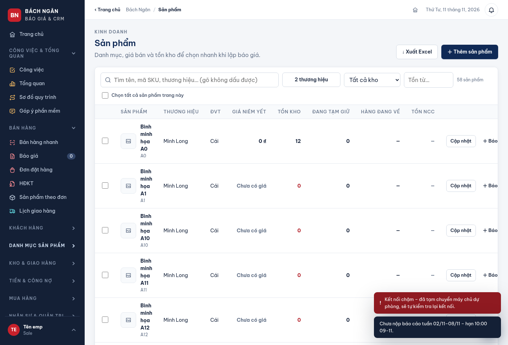

# GY-0011 — Xuất Excel nhiều thương hiệu

## Cách sử dụng

1. Vào **Danh mục sản phẩm → Sản phẩm**.
2. Bấm **Mọi thương hiệu**, tìm theo tên (có thể gõ không dấu), tick các thương hiệu cần lấy rồi bấm **Áp dụng**. Có thể chọn tối đa 100 thương hiệu; tìm kiếm trong popup không làm mất các lựa chọn khác.
3. Không chọn thương hiệu nào nghĩa là **Mọi thương hiệu**. Đóng popup hoặc nhấn Esc sẽ hủy thay đổi chưa áp dụng.
4. Bấm **Xuất Excel**, chọn **Kết quả đang lọc** để lấy chung tất cả sản phẩm của các thương hiệu đã chọn, bao gồm cả những trang sau. Từ khóa và tồn tối thiểu đang lọc cũng được áp dụng.
5. Chọn các cột cần xuất. File giữ một sheet **Sản phẩm**, định dạng ô và bộ lọc Excel hiện có.

Các thương hiệu kết hợp theo **hoặc**; các điều kiện khác kết hợp theo **và**. Hai phạm vi cũ vẫn rõ ràng: **Toàn bộ danh mục** bỏ các bộ lọc trên trang; **Sản phẩm đã chọn** lấy đúng các SKU đã tick, kể cả SKU không còn nằm trong bộ lọc thương hiệu hiện tại. Sản phẩm đã ẩn không được xuất.

## Triển khai và giới hạn

- Không migration, không thay đổi quyền truy cập, dữ liệu, tồn kho hoặc cấu hình Storage.
- API cũ `brand=A` tiếp tục hoạt động. Nhiều thương hiệu dùng `brand=A&brand=B`, không tách theo dấu phẩy; tên có dấu phẩy, `&`, dấu nháy được giữ nguyên.
- `/products` và `/products-export` dùng chung điều kiện thương hiệu và ngưỡng tồn trước phân trang. Luồng xuất trước đây bỏ sót ngưỡng tồn; thay đổi này dùng lại đúng thuật toán đang dùng trên danh sách.
- Giữ cơ chế máy chủ ẩn giá bán/kho riêng. Các SKU đã chọn dùng khóa của Map thay vì chuỗi hóa cả cặp SKU/sản phẩm.
- Giữ giới hạn 50.000 sản phẩm/file đang có. Không thêm tác vụ ghi hay request riêng cho từng thương hiệu.
- Triển khai cùng phiên bản API/UI theo workflow hiện có. Có thể hoàn tác commit; không cần hoàn tác dữ liệu.

## Bằng chứng kiểm thử

Kết quả: nhóm danh mục/tồn/kiến trúc **26/26** đạt; nhóm hồi quy sản phẩm/giao diện **23/23** đạt (4 test GY-0011 được chạy lại ở cả hai nhóm). TypeScript đạt. Browser harness đạt cả 5 file XLSX.

Dữ liệu tổng hợp cục bộ: 63 sản phẩm đang bán, 1 đã ẩn, nhiều kho gồm kho riêng và kho NCC. Không dùng dữ liệu khách hàng, phiên đăng nhập production hay gọi hệ thống ngoài.

- API: hợp nhiều thương hiệu, đủ 58 mã qua hai trang (50 + 8), không trùng; từ khóa/giá/SKU kết hợp; thương hiệu lạ, trùng, dấu phẩy/nháy, giới hạn 100; tương thích một thương hiệu/tất cả.
- Phân quyền: Manager, nhân viên bán hàng, kho, NCC, chưa đăng nhập; giá và kho riêng giữ nguyên quyền; lọc kho không được xem bị từ chối.
- Hồi quy: danh mục, ngưỡng tồn trước phân trang, bảng tồn và kiến trúc; cập nhật, chi tiết, thao tác sản phẩm và bundle giao diện.
- Chromium thật 1440 px và 390 px: tìm không dấu, tick nhiều, Esc không mất bộ lọc, bỏ chọn về tất cả; không tràn ngang, không lỗi JavaScript.
- Tải xuống và đọc lại 5 file XLSX thật: hai thương hiệu 58 mã, tồn tối thiểu 1 mã, đã chọn 1 mã, toàn danh mục 63 mã, tên thương hiệu có ký tự đặc biệt 3 mã. Kiểm tra tiêu đề/thứ tự cột, SKU dạng text, autofilter, không trùng mã.

Chạy lại trình duyệt:

```sh
REVIEW_DIR=/tmp/product-multibrand-review node --import tsx scripts/testing/product-multibrand-export.mjs
```

Cần Playwright/Chromium cài sẵn; có thể chỉ định `PLAYWRIGHT_MODULE`. Script chặn request ngoài localhost. Số đo thời gian mở popup 3 lần được lưu trong [results.json](results.json): median khoảng 77 ms trên dữ liệu thử nhỏ, **không phải thời gian tải trang production**, không có phép đo trước/sau tương đương để kết luận tăng tốc.




