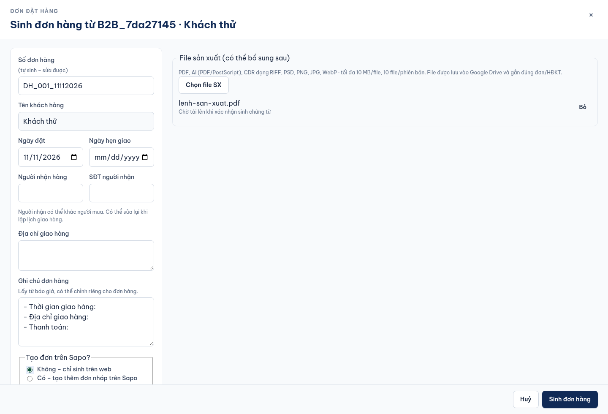
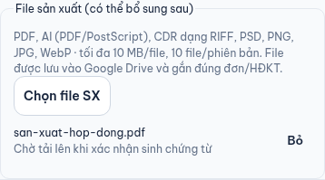
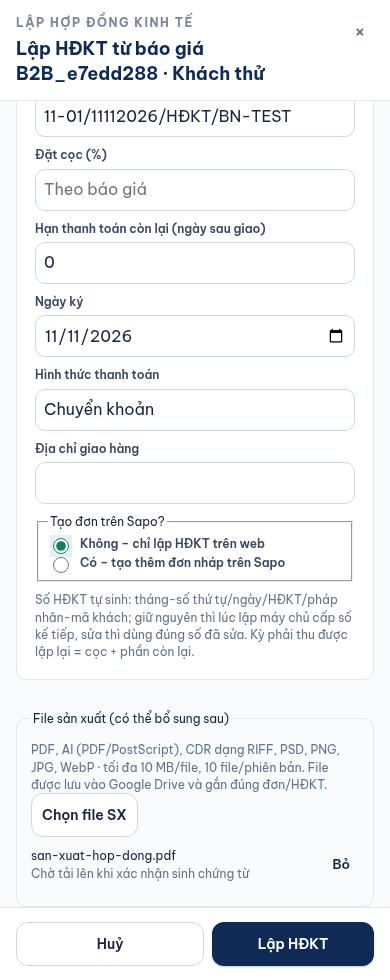

# File sản xuất khi sinh Đơn hàng / HĐKT

## Trạng thái

Đã triển khai source/test và kiểm thử cục bộ. **Chưa deploy, chưa chạy migration trên production, chưa cấu hình OAuth Google Drive trên máy chủ CRM.** Kết nối Google Drive trong cuộc chat không cung cấp credential cho Edge Function và không đồng nghĩa CRM đã kết nối Drive.

Đã tạo và đọc lại thư mục [05 - File sản xuất](https://drive.google.com/drive/folders/1_b5JB9Yj1BGmOc9EOnTHz192n9QmLnIg) trong Drive công ty. Không tải file sản xuất thật, chuyển ảnh hay xóa dữ liệu trên Drive/Supabase.

## Hướng dẫn nhân viên

1. Mở báo giá đã duyệt, chọn **Sinh Đơn hàng / HĐKT** rồi chọn luồng cần lập.
2. Với mẫu **Báo giá Sale**, hoặc báo giá có phí in/mô tả in logo, form xuất hiện mục **File sản xuất**.
3. Bấm **Chọn file SX**, chọn một hoặc nhiều file. Tối đa **10 MB/file, 10 file/phiên bản báo giá**. Chấp nhận PDF, AI dạng PDF/PostScript, CDR dạng RIFF, PSD, PNG, JPG/JPEG, WebP đúng chữ ký file; chưa nhận SVG, ZIP hoặc CDR dạng ZIP. Danh sách định dạng trong popup là giới hạn thực tế, không cam kết mọi phiên bản AI/CDR.
4. File chưa được tải khi vừa chọn. Xác nhận sinh chứng từ: CRM tải từng file lên Drive, kiểm tra kích thước/checksum và đích lưu, rồi mới gửi danh sách file vào giao dịch tạo đơn/HĐKT.
5. Drive lỗi hoặc phản hồi bị gián đoạn: form giữ file và báo lỗi; chưa sinh chứng từ. Bấm lại sẽ đối chiếu cùng ID/file thay vì tạo trùng. Đóng form sau khi file đã lên Drive không xóa file; mở lại báo giá để chọn file đã lưu.
6. Trên đơn/HĐKT, mở **File sản xuất** để tải file. Danh sách chỉ tải khi mở mục này, không thêm request vào lượt tải trang bình thường.
7. **Đính kèm file SX** cho phép bổ sung sau theo quyền sửa chứng từ hiện có: nhân viên trong phạm vi được sửa nháp; chứng từ đã duyệt chỉ Manager được bổ sung. File cũ và liên kết của đơn đã hủy vẫn giữ nguyên; sinh lại không làm mất lịch sử.

Hiện mặc định **không bắt buộc file**, để giữ luồng hiện tại và không tự áp đặt quy tắc chưa được người dùng xác nhận. Có tùy chọn server `PRODUCTION_FILES_REQUIRED=true`; khi bật, máy chủ bắt buộc file cho luồng đủ điều kiện, cả khi bỏ qua UI. Chỉ bật sau khi Drive đã được cấu hình và kiểm tra thật.

## Lưu trữ và phân quyền

- Mỗi báo giá có thư mục Drive riêng dưới **05 - File sản xuất**, tên chứa số báo giá và ID ổn định. File gắn với đúng phiên bản báo giá; không cho lấy file từ báo giá/phiên bản khác vào chứng từ mới.
- DB chỉ lưu metadata và liên kết. Nội dung file nằm trên Drive; không đổi allowlist file của chat, ảnh kho hoặc các module khác.
- Drive ID được cấp và ghi DB trước khi tải. Retry sử dụng lại ID; đối chiếu MD5 của Google và SHA-256 nguồn. Không ghi đè nội dung phiên bản cũ; file giống nhau trong cùng phiên bản được tái sử dụng.
- Tải file qua route CRM kiểm phạm vi báo giá/đơn/HĐKT, trả dạng attachment, không nhúng HTML/SVG thực thi và không công khai link/credential Drive. Backend kiểm lại đích, kích thước/checksum trước khi tải.
- Kiểm tra quyền Drive qua API chỉ đọc, chặn quyền `anyone` trước khi tạo thư mục và khi xác minh file. Không gọi API thêm/chỉnh quyền. Người được cấp quyền trực tiếp trên Drive vẫn có quyền theo thư mục cha; nên giới hạn root cho tài khoản công ty/quản trị, nhân viên thao tác qua CRM để áp dụng đúng phạm vi CRM. Kết quả kiểm quyền chia sẻ chưa được xác minh trên Drive production trong phiên này.
- Upload chỉ cho người có quyền sửa báo giá. File liên kết sang chứng từ trong cùng giao dịch tạo chứng từ, không gọi mạng Drive bên trong giao dịch/khóa sổ kho. File không làm thay đổi tiền, công nợ, tồn hoặc lựa chọn Sapo.
- Báo giá có hồ sơ file SX không được xóa cứng để giữ liên kết lịch sử; API trả lý do riêng thay vì báo nhầm đã có đơn. Không tự xóa file Drive khi hủy chứng từ.
- Ghi audit metadata, không ghi bytes/base64, OAuth token hoặc bí mật. Không tự dọn/xóa file chưa gắn chứng từ; cần quy trình đối soát riêng trước khi dọn.

## Triển khai

1. Review và chạy thủ công migration **migrations/postgres/20261111124855_sales_production_files.sql** theo quy trình dự án. Ba bảng mới bật RLS và không cấp quyền trực tiếp cho anon/authenticated; không sửa đơn/tiền/tồn cũ.
2. Chạy gate chỉ đọc **scripts/sql/assert-production-files.sql**. Workflow deploy API đã bổ sung gate sớm, trước thay đổi secrets/API. Chưa có migration thì dừng deploy.
3. Cấu hình tại **Supabase → Edge Functions → Secrets**, chỉ trên máy chủ:
   - `GOOGLE_DRIVE_CLIENT_ID`
   - `GOOGLE_DRIVE_CLIENT_SECRET`
   - `GOOGLE_DRIVE_REFRESH_TOKEN`
   - `GOOGLE_DRIVE_PRODUCTION_FOLDER_ID` = `1_b5JB9Yj1BGmOc9EOnTHz192n9QmLnIg`
   - `PRODUCTION_FILES_REQUIRED` = `false` ban đầu.
4. OAuth app phải bật Drive API và được tài khoản công ty ủy quyền truy cập thư mục đích. Thiết lập credential bằng luồng Google OAuth quản trị; không gửi giá trị secret vào chat/repository/frontend. Dùng OAuth cho My Drive hiện tại; không tự coi tài khoản kết nối trong chat là kết nối server.
5. Deploy API rồi UI qua workflow hiện có, thử trên môi trường riêng bằng tài khoản đúng phạm vi, xác minh file thực tế và quyền Drive trước khi bật dùng rộng rãi/bắt buộc.

Thiếu cấu hình: form báo rõ, khóa tải file mới; chế độ tùy chọn vẫn sinh chứng từ không file như trước. Cấu hình folder ID sai không làm sập toàn bộ API. Không áp dụng migration hay đặt secret từ script browser.

## Kết quả kiểm thử

**72 test liên quan đạt, không lỗi**: nhóm file/form/UI/kiến trúc/RLS 26, hồi quy sales 9, hồi quy Sapo/nguồn hàng 36, thêm 1 kiểm thử chặn Drive công khai. Nhóm file/Drive/RLS cuối cùng chạy lại 9/9. TypeScript và kiểm tra cú pháp/diff đạt.

- Mất phản hồi Drive, gửi lại cùng ID hoặc cùng bytes không tạo file trùng; khác nội dung cùng client ID bị chặn.
- File khác báo giá, chưa sẵn sàng hoặc sai revision: rollback tạo chứng từ. Cờ bắt buộc được kiểm ở server; luồng tùy chọn cũ tiếp tục chạy.
- Quyền người phụ trách/cùng nhóm theo CRM, người khác phạm vi, NCC, Manager; tải xuống đúng bytes; bổ sung trên chứng từ đã duyệt bị chặn với nhân viên; lịch sử giữ sau hủy/sinh lại.
- RLS/không có grants trực tiếp cho browser; gate phát hiện thiếu cột proof. Adapter dùng host OAuth/Drive cố định, không chuyển hướng credential, không thay quyền chia sẻ, chặn đích công khai trước khi ghi.
- Chromium thật PC 1440 px/mobile 390 px với API/router/DB thật trên fixture và Drive giả: sinh đơn/HĐKT, chưa upload trước xác nhận, mất phản hồi sau commit/retry, tải file, bổ sung sau, chưa cấu hình Drive và tiếp tục không file. Không lỗi JS/tràn ngang.

Mở form đủ dữ liệu cục bộ 3 lần: median khoảng **426 ms** (bản đã cập nhật main) (chi tiết [results.json](results.json)). Đây là fixture nhỏ và Drive giả, **không phải tốc độ production hoặc độ trễ tải lên Google Drive thật**; chưa có dữ liệu trước/sau tương đương. Chưa xác minh OAuth production, quota hoặc latency Google thật.

Chạy lại browser:

```sh
REVIEW_DIR=/tmp/production-files node --import tsx scripts/testing/production-files.mjs
```

Cần Playwright/Chromium; có thể đặt `PLAYWRIGHT_MODULE`. Script chặn mọi request ngoài localhost.







## Thư mục con giới hạn quyền, giữ nguyên vị trí (18/11/2026)

Google Drive hỗ trợ Limited access cho thư mục con bằng
`inheritedPermissionsDisabled=true`. Quyền kế thừa từ thư mục mẹ có thể vẫn xuất
hiện trong API dưới dạng `type=anyone`, `role=reader`, `view=metadata`: quyền này
chỉ nhìn thấy tên/metadata thư mục, không mở thư mục hoặc đọc file bên trong.

Adapter yêu cầu thêm `role`, `view`, `inheritedPermissionsDisabled` và thông tin
kế thừa trong phản hồi kiểm quyền. Chỉ chấp nhận quyền metadata khi Google trả
đủ `role=reader`, `view=metadata`, `inheritedPermissionsDisabled=true` và không
có chi tiết quyền trực tiếp mâu thuẫn. Quyền công khai đọc/sửa nội dung, quyền
published hoặc thiếu bằng chứng vẫn bị chặn, kể cả ở trang permission tiếp theo.
Không thêm API ghi permission vào backend, không đổi OAuth, checksum, cơ chế
retry hay đích lưu; không cần migration.

Đã bật giới hạn truy cập riêng trên “05 - File sản xuất”, giữ nguyên parent và
16 quyền trực tiếp của nhân viên. Bộ kết nối Drive hiện tại trong chat không trả
các trường limited-access trong kết quả chuẩn hóa; đối chiếu hộp chia sẻ đã lưu,
parent ID, số quyền và việc quyền kế thừa chuyển từ writer sang reader. Cấu hình
OAuth trên máy chủ và upload thực tế qua CRM vẫn phải xác minh riêng; kết nối
Google trong chat không thay thế OAuth của Edge Function.

Tài liệu Google:
- https://developers.google.com/workspace/drive/api/guides/limited-expansive-access
- https://developers.google.com/workspace/drive/api/reference/rest/v3/permissions

Kiểm thử adapter bao gồm quyền metadata hợp lệ, thiếu bằng chứng, quyền đọc/sửa
công khai, mâu thuẫn quyền trực tiếp, published và quyền công khai ở trang sau.
Kiểm thử routes/file/RLS được chạy cùng để giữ phạm vi dữ liệu và rollback.
