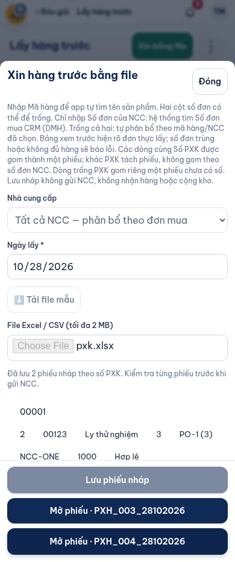

# Kiểm tra PR tổng hợp ngày 28/10/2026

Fixture nội bộ, router/PGlite thật + Chromium, chặn mạng ngoài localhost. Không sửa hoặc gửi dữ liệu production.

## Thay đổi và giới hạn

1. **Xin hàng bằng Excel:** bỏ nút Tải file mẫu tại đầu danh sách, giữ nút trong popup. Mẫu có thêm Số PXK dạng Text. Cùng PXK gom một phiếu, khác PXK tách phiếu, không gom theo số đơn NCC. Số đơn CRM/NCC vẫn dùng ghim đúng nguồn. Dòng chưa có PXK được gom riêng một phiếu chưa có số, có ghi rõ trong mẫu/popup; mẫu cũ vẫn đọc được. Số PXK lưu ở metadata scope hiện có, hiện trong danh sách/chi tiết và tìm kiếm được.
2. **Menu và đăng nhập:** mặc định mở Công việc & tổng quan và Bán hàng, các nhóm khác đóng; vẫn bấm đóng/mở được. Đăng nhập mới của nhân viên có quyền page.flow vào Sơ đồ quy trình. Không cấp quyền mới: nếu chưa có quyền sơ đồ thì dùng trang dự phòng theo quyền hiện hành. Khôi phục phiên giữ URL đang xem; Manager giữ trang mặc định cũ.
3. **Tên phiếu thu/chi:** gợi ý Nộp quỹ, Tạm ứng lương, Phí GHN, Phí vận chuyển, Phí khác cùng các tên cũ, theo chiều thu/chi phù hợp. Nhập tên mới ngay trong ô Tên phiếu. Sau khi lưu phiếu thành công, tên đó được gợi ý lại từ các phiếu mà tài khoản có quyền xem tại két đang chọn, kể cả sau tải lại trang. Không tạo danh mục qua thao tác riêng, không lưu tên trên thiết bị và không mở rộng quyền đọc sổ người khác. Không đổi số tiền, ngưỡng duyệt, cách duyệt hoặc hiệu lực ghi sổ.
4. **Sản phẩm:** popup cập nhật có số SP/thùng, dài/rộng/cao thùng (cm), cân nặng thùng (kg), theo xác nhận của chủ repo. Dùng các cột hiện có; không phải thông số một sản phẩm. Trường không gửi giữ nguyên, null có thể xoá giá trị; giữ kiểm tra phiên bản chống ghi đè và audit. Chân Lưu/Huỷ cố định, thân form cuộn; mobile tiếp tục chỉ xem/tra cứu như quy tắc hiện tại.
5. **Đơn hàng:** cột giao hàng có mã vận đơn và trạng thái GHN đã lưu, kèm link lịch giao. Hiện cả trên thẻ mobile. Nhiều vận đơn được giữ đầy đủ, trạng thái mới chưa biết giữ nguyên mã gốc; không suy trạng thái GHN từ trạng thái giao thủ công. Chỉ đọc snapshots, không gọi/tạo/cập nhật/huỷ vận đơn GHN.

Không thay schema/migration/dependency; không đổi công thức tiền/thuế/chiết khấu, tồn kho, Sapo/GHN/cron. Có bổ sung API ở phạm vi yêu cầu:

- `POST /purchase-early-requests/file`: một transaction, một retry key cho toàn file. Khoá toàn bộ SKU/đơn nguồn theo thứ tự ổn định và dùng hạn mức chung theo dòng đơn mua; vượt số lượng ở một nhóm rollback tất cả. Kết quả batch và hash lưu trong audit hiện có. Retry sau mất phản hồi trả lại các phiếu đã tạo. Chỉ Manager/Sale Admin có quyền xin hàng trước như API cũ. Lưu nháp không tự gửi NCC hoặc nhập kho.
- `GET /cash/entry-names?direction=in|out`: chỉ trả tối đa 100 tên từ phần tên phiếu của các giao dịch tài khoản được phép xem trong két; không trả nội dung lý do hoặc tiền. Không phát sinh ghi sổ.
- API cập nhật sản phẩm nhận các trường quy cách thùng hiện có; `/orders` thêm danh sách GHN theo ID các đơn đã qua lọc quyền/phân trang, một query cho cả trang.

## Kiểm thử đã qua

- Typecheck, build UI, git diff --check, 5 test kiến trúc. Chạy lại 6 file test chính bằng Node 22 giống CI: tất cả qua.
- 2 test parser/API PXK: cùng mã ở hai PXK; cùng PXK khác đơn NCC; giữ số 0 đầu; idempotency; đổi nội dung cùng key bị chặn; giới hạn nguồn dùng chung; rollback; API cũ giữ dạng payload cũ; không gửi NCC, tạo phiếu nhận, ghi kho hay tạo job Sapo.
- 4 test file cũ/Excel/CSV; 5 file regression early-order-sources, purchase-early-sources, purchase-early-requests, early-request-receiving, early-request-page.
- 3 test tên thu/chi/duyệt; 5 test UI sổ quỹ; 15 test sổ quỹ; tên mới dùng lại đúng chiều thu/chi, chặn tài khoản NCC và két ngoài cửa hàng.
- 3 test cập nhật sản phẩm (quyền/giá/stock, chống ghi đè, số đo/null/audit); 2 test trang sau đăng nhập; test login focus.
- 2 test GHN (phạm vi đơn, nhiều vận đơn, trạng thái, mã hoá link và text), test lọc công nợ/lịch giao; 9 test luồng bán hàng.
- Browser `scripts/testing/pxk-cash-login-review.mjs`: trước ở 390/1280px, sau ở 360/390/430/768/1280px. Tải mẫu thật; cùng mã/nguồn ở 2 PXK; nhiều đơn NCC trong 1 PXK; lưu nháp/retry mất phản hồi giữ 2 phiếu; tên phí mới còn sau reload; cả thu và chi có gợi ý; cập nhật thùng đọc lại đúng; nút Lưu luôn trong màn hình; mặc định nhóm menu/đăng nhập; GHN hiện trên desktop/mobile. Tồn sản phẩm trước/sau giống nhau; không gọi nhận hàng/gửi NCC/Sapo/GHN. Không lỗi JS hoặc tràn ngang toàn trang (bảng xem trước có khung cuộn riêng).
- Browser mock file nhập cũ ở 390/1280px qua, gồm lỗi dữ liệu, nguồn trùng, phân bổ trống và retry cùng key.

Chưa chạy toàn bộ test repository local; bộ tổng chạy qua CI của PR. Chưa merge hoặc deploy. Chưa kiểm tra thiết bị iPhone/Safari thật.

## Ảnh đối chiếu

| Màn hình | Trước | Sau |
|---|---|---|
| Danh sách xin hàng và menu desktop | [1280px](before-early-1280.png) | [1280px](after-early-1280.png) |
| Cập nhật sản phẩm | [1280px](before-product-1280.png) | [1280px](after-product-1280.png) |
| Phiếu chi mobile | [390px](before-cash-390.png) | [390px](after-cash-390.png) |
| GHN trên danh sách đơn | [1280px](before-orders-1280.png) | [1280px](after-orders-1280.png), [390px](after-orders-390.png) |

Kết quả browser: [trước](before-results.json), [sau](after-results.json).
