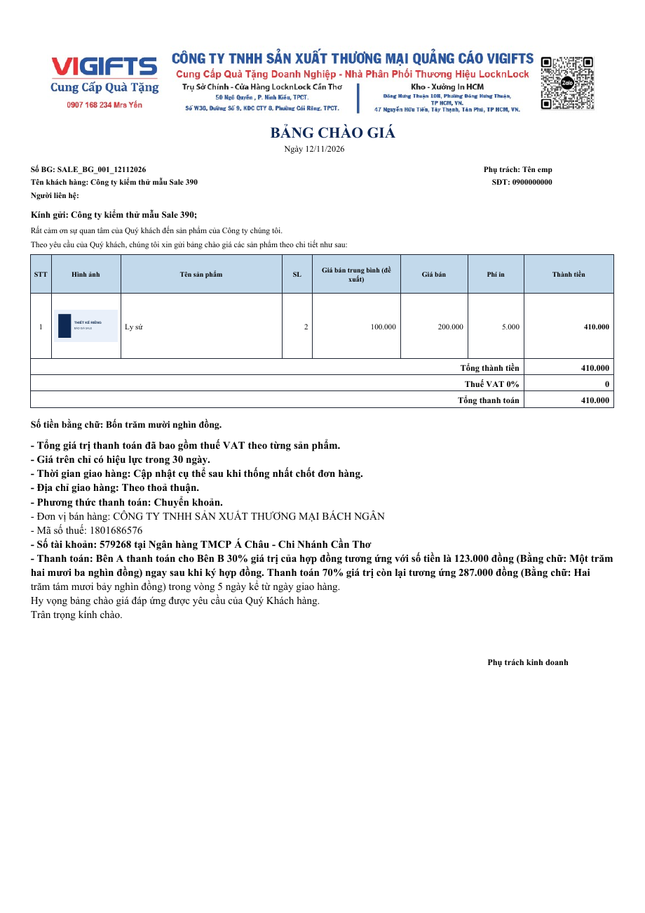

# PDF Sale dùng mẫu Vigifts

Nút **Tải xuống → PDF cho Sale** trước đây dựng một bảng A4 ngang riêng, thiếu khung báo giá Vigifts. Bản sửa dùng chung `EditableQuotePdf.create` với mẫu Vigifts: letterhead, A4 dọc/lề, thông tin báo giá/khách/phụ trách, lời chào, tổng tiền/VAT, số tiền bằng chữ, ghi chú và chữ ký. Chỉ bảng sản phẩm chuyển sang tám cột Sale đang dùng trong giao diện/Excel.

- Không đổi `state.type` để ép mẫu: HRC vẫn không cộng phí in, B2B/Vigifts giữ phí in và VAT theo dữ liệu báo giá.
- PDF hiện thông tin khách và ghi chú báo giá như mẫu Vigifts. Bảng sản phẩm vẫn lấy allowlist: không xuất SKU, ĐVT, CK, giá vốn, hoa hồng hoặc ghi chú nội bộ. Excel giữ nguyên bảng tám cột và allowlist hiện có.
- Tên dài được ngắt qua trang, lặp đầu bảng, không lặp số lượng/thành tiền/ảnh trên phần tiếp theo của cùng sản phẩm. Ảnh trùng được nhúng một lần. Ghi chú in đậm được đo bằng font đậm để không tràn lề.
- Bộ PDF và letterhead chỉ tải khi bấm xuất. Thiếu letterhead báo lỗi rõ ràng; không tạo file thiếu đầu trang. Giữ các bước kiểm duyệt/revision/phạm vi truy cập đang có.

## Kiểm thử cục bộ

- `tests/app/sale-quote-export.test.ts`: 5 test đạt. Đọc lại PDF thật bằng PDF.js; kiểm A4 dọc, vị trí header trùng mẫu Vigifts, tổng tiền cho ba loại báo giá, 90 dòng/tên rất dài/ghi chú nhiều trang, giới hạn lề và trường riêng tư; hồi quy cột PDF thường và Excel.
- `tests/app/sale-quote-template.test.ts`, `tests/app/stock-shortage-pdf.test.ts`: đạt.
- TypeScript, cú pháp JavaScript, UI build và `git diff --check`: đạt.
- Chromium thật, router/DB fixture: `scripts/testing/sale-quote-exports.mjs` xuất PDF/Excel cho HRC, B2B, Vigifts; xuất không gọi write API/checkout.
- `scripts/testing/sale-quote-layout.mjs`: mẫu Sale có ảnh thiết kế riêng, tạo/lưu/duyệt/xuất trên 390/768/1280/1920 px; giữ chặn xuất bản nháp, giá bình quân 100.000, thành tiền 410.000, không sửa ảnh catalogue, không lỗi JavaScript. Xem [kết quả browser](browser-results.json).

Dùng dữ liệu giả và chặn mọi request ngoài localhost. Chưa triển khai production, chưa kiểm tra máy in thật/iOS. Không thay migration hoặc dữ liệu production. Các thời gian chạy script không phải số đo tốc độ CRM production.

