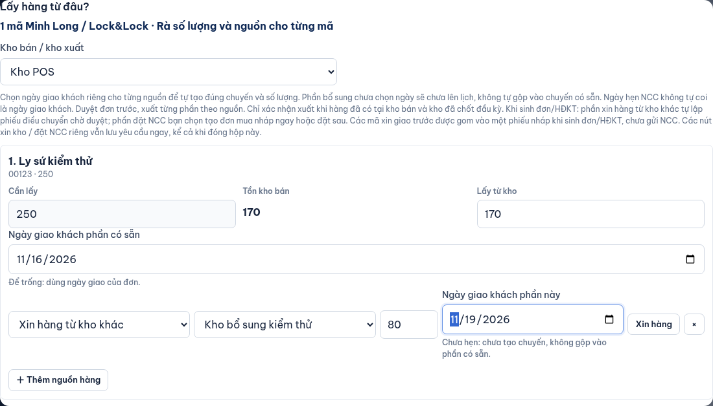
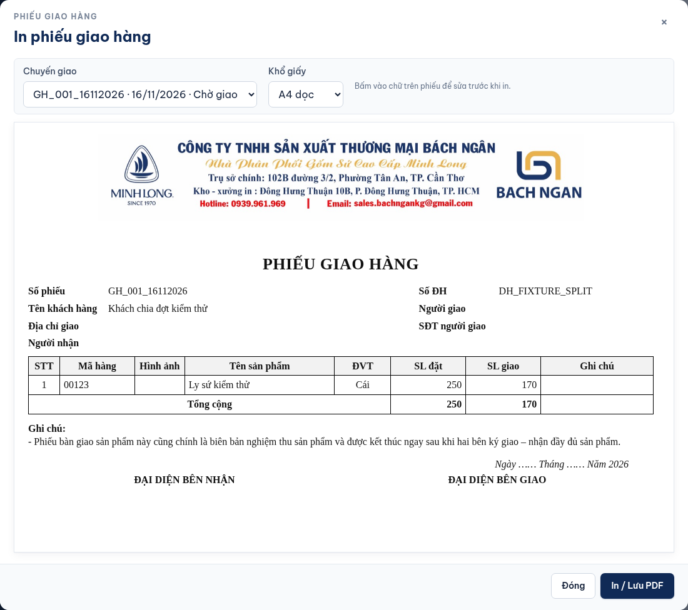
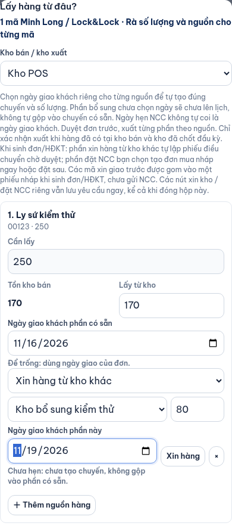

# Chia ngày giao theo nguồn hàng

Trước đây, duyệt đơn có kế hoạch đóng gói gọi `ensurePackingSchedule()` nhưng không truyền dòng hàng. `createScheduledDelivery()` hiểu đây là toàn bộ hàng chưa lên lịch. Vì vậy 2 phiếu nguồn 170 + 80 vẫn sinh một chuyến 250; mẫu in lấy đúng 250 từ dữ liệu chuyến đó.

## Nhân viên thực hiện

1. Khi sinh đơn/HĐKT, trong **Lấy hàng từ đâu?**, chia số lượng có sẵn và nguồn bổ sung như trước.
2. Nhập **Ngày giao khách phần có sẵn**. Bỏ trống thì dùng ngày giao dự kiến của đơn, hoặc ngày lập lịch hiện tại nếu đơn chưa hẹn.
3. Với từng nguồn bổ sung, nhập **Ngày giao khách phần này** đã thống nhất. Ngày NCC hẹn về chỉ là thông tin nguồn, không tự chuyển thành ngày giao khách.
4. Phần bổ sung chưa hẹn ngày vẫn được lưu trong kế hoạch, nhưng chưa tạo chuyến và không cộng vào chuyến đầu. Trang đơn báo rõ hàng còn chưa lên lịch; dùng **＋ Lên lịch giao** khi chốt được ngày.
5. Duyệt đơn tạo chuyến theo từng ngày và đúng lượng được phân bổ. Cùng ngày đã chọn rõ có thể gộp một chuyến; khác ngày giữ riêng. Ví dụ 170 ngày 16/11 và 80 ngày 19/11 tạo hai chuyến 170 và 80.
6. Trong **In phiếu giao hàng**, chọn đúng chuyến. **SL đặt** là tổng đặt của dòng (250); **SL giao** là lượng chuyến đang chọn (170 hoặc 80). Lựa chọn tổng đã được ghi rõ **Toàn bộ hàng chưa giao (gộp các chuyến)**.

Hàng đã giao hết không được tự thay bằng tổng đặt khi in phần còn lại. Chuyến không tồn tại, dòng không thuộc đơn hoặc lượng không hợp lệ báo lỗi thay vì tự đổi chuyến/tổng lượng.

## An toàn và tương thích

- Migration `20261113074715_split_packing_delivery_dates.sql` thêm hai cột nullable `plan_source`, `planned_delivery_date`, có kiểm tra loại nguồn/ngày. Đã chạy production và đồng bộ lịch sử đúng version trước khi mở PR.
- Không tự tách hoặc đổi ngày của các lịch đã tồn tại, kể cả lịch đã hủy. Không bulk backfill ngày từ ghi chú NCC.
- Một phiếu cũ chưa có lịch chỉ lên lịch đúng lượng của phiếu đó. Nhiều phiếu cũ không có ngày rõ ràng cần lên lịch thủ công, không tự gộp tất cả.
- Quyền duyệt, xem đơn và lập lịch giữ nguyên. Lập lịch nằm trong giao dịch duyệt, khóa đơn và cấp số theo ngày; chưa duyệt không tạo chuyến, gọi lại không nhân đôi.
- Ngày dự kiến của đơn và hạn giữ tồn tự động theo chuyến đầu thực tế, tránh dùng ngày tổng cũ khi đã đổi ngày từng nguồn.
- Không xuất kho hoặc ghi nhận thanh toán khi lập lịch.
- Đơn người dùng chỉ định đã được sửa riêng theo xác nhận 170 ngày 16/11/2026 và 80 ngày 19/11/2026, giữ số chuyến đầu, lưu audit idempotent. Đối chiếu trước/sau: tổng 19.197.000đ, phiếu thu 0, xuất kho 0 giữ nguyên. Đây là sửa dữ liệu được ủy quyền, không nằm trong migration hay fixture.

## Kiểm thử

- `warehouse-sales.test.ts`: đầy đủ luồng kho/quyền, thêm tái hiện 170/80, ngày khác/ngày bằng nhau, ngày lỗi rollback, bỏ trống ngày nguồn bổ sung, ngày NCC trong ghi chú không được suy đoán, giữ tồn và không lặp chuyến.
- `split-delivery-legacy.test.ts` và `order-stock-holds.test.ts`: nhiều phiếu cũ không bị gộp; lịch thủ công được giữ; ngày dự kiến và hạn giữ tồn theo ngày chuyến đầu thực tế.
- `quote-sourcing-ui.test.ts`: nhập/truyền ngày riêng của kho và nguồn bổ sung; nguồn chưa hẹn không có ngày giả.
- `delivery-slip-links-ui.test.ts`: chọn chuyến in 170/80, SL đặt 250, chuyến/dòng lỗi và đơn đã giao hết.
- Regression đạt: packing, printed-line-order, order-print, order-print-form, order-create-ui và kiến trúc module; TypeScript, build trial UI, diff check.
- Chromium thật + router/PGlite: Manager và người phụ trách ở 390/1440px; mở đúng phiếu, đổi cả hai chuyến, kiểm tra cột SL đặt/SL giao; nhập 16/11 và 19/11 trên form nguồn thật. Không lỗi JS, form ngày không tràn ngang. Khổ giấy A4 vẫn cuộn ngang trong preview mobile theo mẫu in hiện tại.
- Năm lần GET order ấm mỗi vai trò/viewport: median local 27–71 ms, xem [results.json](results.json). Đây là fixture timing, không phải số đo production.

```sh
node --import tsx --test --test-concurrency=2 tests/app/warehouse-sales.test.ts tests/app/quote-sourcing-ui.test.ts
PLAYWRIGHT_MODULE=/path/to/playwright/index.mjs REVIEW_DIR=/tmp/split-delivery node --import tsx scripts/testing/split-delivery-plans.mjs
```







