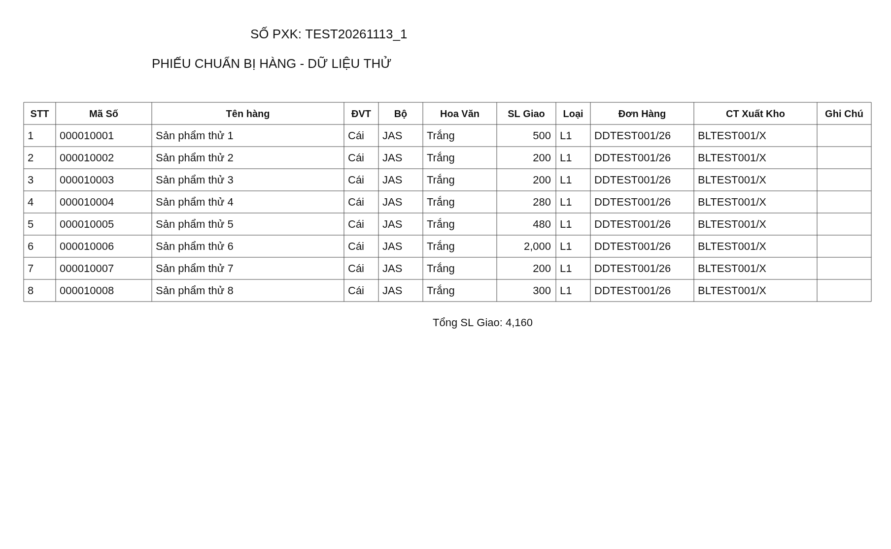
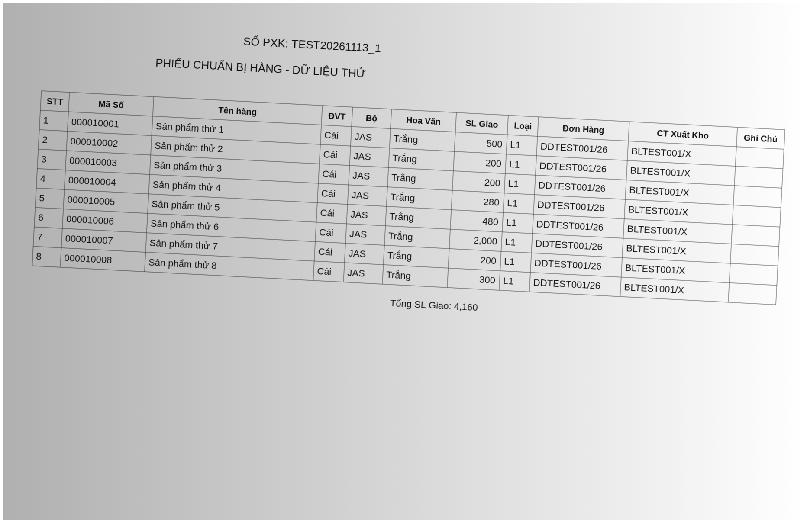

# OCR phiếu có Mã Số / SL Giao

Ảnh phản hồi hiển thị phiếu bảng kẻ với tiêu đề **Mã Số**, **SL Giao**, **Đơn Hàng**, số PXK ở đầu phiếu; bản ảnh gửi kèm còn xoay ngang và có bóng tối. Thông báo “Không xác định chắc chắn cột…” xuất phát từ parser sau OCR, không phải lỗi gọi API hay ghi kho.

## Nguyên nhân và sửa

- Parser cũ không có nhãn Mã Số; SL Giao bị tách thành SL và Giao, giới hạn vùng số lượng sai. Bản mới nhận trọn tiêu đề và phân cột theo tâm ô/đầu cột lân cận, không theo mép trái chữ tiêu đề (giá trị có thể căn phải).
- Chế độ khối chữ bỏ qua ô trong bảng kẻ. Dùng sparse OCR, ghép các ô thành hàng theo tọa độ; xử lý độ sáng cục bộ, bỏ đường kẻ dài, giữ nét ký tự ngắn.
- Tự thử 0/90/270/180°, cân nghiêng nhỏ bằng phép chiếu nét chữ/đường kẻ. Có lựa chọn hướng thủ công. Upscale có giới hạn; ảnh không được gửi đi.
- SL dạng phân cách nghìn rõ 2,000 / 2.000 thành 2000; không chấp nhận số thập phân hoặc nhóm số sai. Dừng đọc hàng tại Tổng SL Giao/Tổng số lượng/Tổng cộng để không nhận nhầm chân phiếu.
- Số PXK bị OCR tách hậu tố (TEST20261113_1 → TEST20261113 1) được giữ đủ phần đọc thấy và đánh dấu cần nhập lại, không âm thầm cắt thành TEST20261113. Nhân viên phải sửa trường số chứng từ hoặc nhập số riêng từng dòng trước khi tiếp tục. Không tự thay O/0, l/1 hay đoán dấu nối.
- Giữ phân loại đơn CRM/NCC, xem ảnh gốc, xác nhận và API đối chiếu/lưu nháp hiện có. Không tự gửi NCC/ghi sổ kho. Sửa thông báo thiếu dòng để hướng dẫn đọc lại ảnh/thêm dòng, thay vì nhắc file mẫu Excel.

## Kiểm chứng

Ảnh gốc trong chat được xem để xác định mẫu/lỗi; không được đưa vào repository. Kiểm thử OCR tự động dùng **ảnh dựng tổng hợp** với SKU/đơn/PXK giả, cùng bố cục 11 cột, 8 dòng, tổng 4.160; không khẳng định đã chạy OCR trên chính tệp ảnh gốc.

Chromium + Tesseract thật, chặn mọi request ngoài localhost:

| Ảnh thử | Hướng tự chọn | Dòng / tổng | Thời gian máy thử |
|---|---:|---:|---:|
| Thẳng, bảng kẻ | 0° | 8 / 4.160 | ~4,2 s |
| Xoay phải 90° | 270° | 8 / 4.160 | ~8,1 s |
| Xoay trái 90° | 90° | 8 / 4.160 | ~4,4 s |
| Nghiêng 3° + bóng tối | 0°, cân nghiêng 3° | 8 / 4.160 | ~3,6 s |

Đọc đúng 8 SKU có số 0 đầu, số lượng và đơn hàng, bỏ cột CT Xuất Kho và dòng tổng. Số PXK có thể cần sửa hậu tố theo cảnh báo. Kết quả đầy đủ: [results.json](results.json). Đây là số đo local desktop, không phải cam kết tốc độ điện thoại hoặc độ chính xác ảnh mờ/chữ viết tay/perspective nặng.

Regression parser, nhập file, trial-ui, architecture đạt. Luồng router/PGlite: PC 1440px và mobile 390px kiểm số đơn/PXK, xác nhận rồi lưu nháp đúng nguồn đạt; không lỗi JS. TypeScript, build UI, diff check. Không có migration/secret mới; chưa deploy production.

```sh
PLAYWRIGHT_MODULE=/path/to/playwright/index.mjs node --import tsx scripts/testing/supplier-slip-ocr.mjs
PLAYWRIGHT_MODULE=/path/to/playwright/index.mjs node --import tsx scripts/testing/early-photo-request.mjs
node --import tsx --test --test-concurrency=2 tests/app/early-photo-ocr.test.ts tests/app/purchase-early-file.test.ts tests/app/trial-ui.test.ts tests/architecture.test.ts
```



