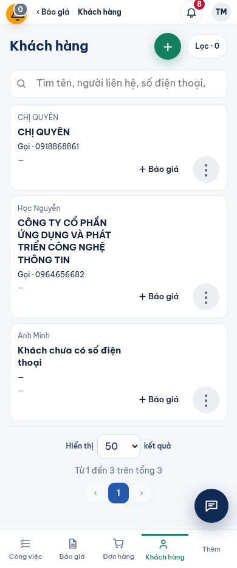
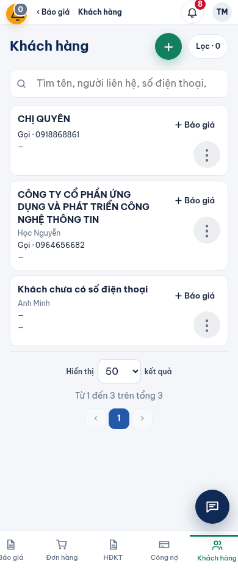
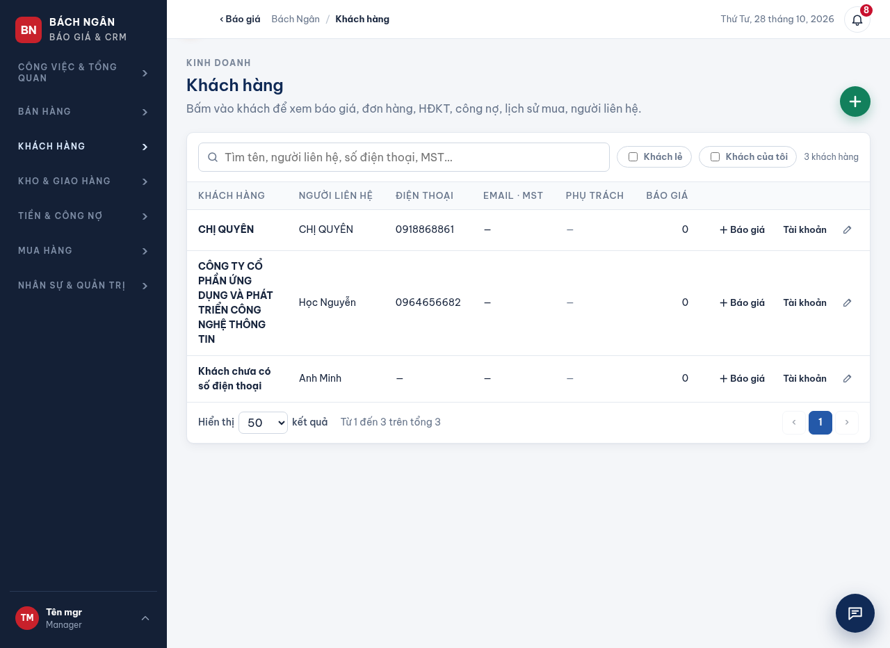
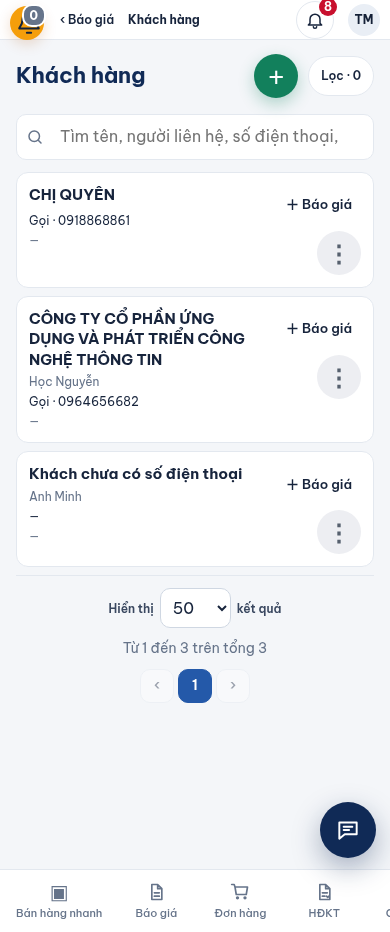

# Ba thay đổi giao diện – 28/10/2026

Dữ liệu kiểm thử nội bộ bằng router CRM/PGlite thật và Chromium, không dùng dữ liệu production. Nhận hàng chỉ được tạo khi chuẩn bị fixture; thao tác trình duyệt không phát sinh request ghi nghiệp vụ. Chưa merge/triển khai.

## Lỗi trước sửa và kết quả

| Khu vực | Trước | Sau |
|---|---|---|
| Danh sách xin hàng | Nhận đủ 52/52 vẫn ghi “NCC đồng ý” | Thay nhãn bằng “SL xin 52 · Đã nhận 52” xanh lá; không lặp số lượng bên dưới |
| Phiếu nhận một phần/chưa nhận | Có nhãn NCC và số lượng | Giữ nhãn NCC; vẫn hiện SL xin và đã nhận |
| Khách hàng mobile | Liên hệ trùng tên, nội dung và nút nằm ở các hàng tách rời | Tên/liên hệ/điện thoại/phụ trách bên trái, nút báo giá và menu bên phải ngang đầu thẻ; chỉ ẩn liên hệ nếu trùng tên |
| Menu mobile | 4 mục + “Thêm”, trang khác phải mở sheet | Liệt kê các mục theo quyền trong một thanh vuốt ngang; thứ tự đầu: Bán hàng nhanh, Báo giá, Đơn hàng, HĐKT, Công nợ |

Ở 390px, chiều cao ba thẻ khách fixture lần lượt **140,6 / 201,4 / 160,9px → 116 / 147,3 / 116px**. Ở 1280px, ba dòng giữ nguyên **58,5 / 151 / 66,5px**. Nút gọi giữ `tel:`, nút báo giá giữ dữ liệu khách đã chọn; ⋮ tiếp tục mở được menu. Thẻ tên dài và khách không có điện thoại đều được kiểm tra.

Số lần chạm (không tính thao tác nhập chữ hoặc vuốt thanh menu): mở chi tiết khách **1 → 1**; gọi khách **1 → 1**; tạo báo giá từ thẻ **1 → 1**; mở Lấy hàng trước/Công nợ từ các mục trước nằm trong Thêm **2 → 1** (có thể cần vuốt để đưa mục vào màn hình); đóng sheet Thêm **1 → không còn sheet**. Số lượng nhận đủ có thể đọc ngay trên thẻ, không cần mở chi tiết.

Menu dùng các link sidebar đã được lọc quyền, không cấp thêm quyền. Mục đang xem được đưa vào vùng nhìn thấy của thanh, không cuộn dọc trang. Không dựng lại menu khi chỉ badge thay đổi. Trang POS giữ cơ chế ẩn thanh dưới để bảo toàn bố cục thanh toán.

## Xác minh

- Script `scripts/testing/three-ui-review.mjs`: trước sửa ở 390/1280px; sau sửa ở 360/390/430/768/1280px. Đã kiểm tra ảnh, không tràn ngang toàn trang, không lỗi JS, menu đủ các mục sidebar không trùng, vuốt/cuộn ngang, Back/Forward và tài khoản kho không thấy mục quản trị.
- `scripts/testing/mobile-workflow-regression.mjs`: cả 5 kích thước qua. Lọc chỉ áp dụng khi bấm Xem; giữ focus, chi tiết HĐKT ở trang đầy đủ sau 5 lần refresh, Back/Forward, POS không bị gom menu, gửi duyệt không xảy ra nếu lưu lỗi.
- Typecheck, build UI, 5 file test liên quan (`mobile-density-ui`, `mobile-action-policy`, `quote-mobile-ui`, `early-list-bulk-ui`, `early-receipt-form-ui`) và `git diff --check` qua.
- Không đổi API/schema/quyền/công thức hoặc ghi tồn; chưa chạy lại toàn bộ test repository cho thay đổi giao diện này. CI của PR chạy bộ tổng riêng.

## Ảnh đối chiếu

### Khách hàng 390px

| Trước | Sau |
|---|---|
|  |  |

### Khách hàng 1280px

| Trước | Sau |
|---|---|
|  |  |

### Phiếu xin hàng

[Trước 390px](before-early-390.png) · [Sau 390px](after-early-390.png) · [Trước 1280px](before-early-1280.png) · [Sau 1280px](after-early-1280.png).

### Thanh menu vuốt ngang

Số đo: [trước](before-results.json), [sau](after-results.json). Ảnh và số liệu là fixture, không phản ánh khách/phiếu production.
